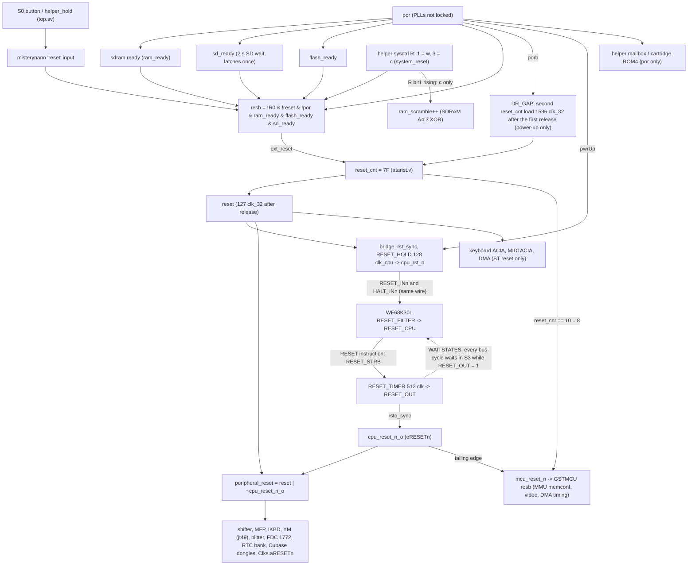

# Reset paths: core, bridge, ST chipset vs a real STE and the TF534

Written 15 Oct 2026 (warm-reset branch, after the F67 board test failed). This is read-only analysis plus GHDL sims. Nothing was flashed.
The sources are `misterynano.sv`, `atarist/atarist.v`, `cpu030/cpu030_st_bridge.v`, `cpu030/wf68k30L_bus_interface.vhd`
and `tang/console138k/top.sv`. The hardware references are the STE motherboard C300780-001 (sporniket KiCad conversion,
netlisted from the sheets) and the TF534 Eagle schematic (agranlund/tf534 `eagle/tf534.sch`).

## 1. Our design



**Feedback check.** No path leads from `RESET_OUT`/`cpu_reset_n_o`/`peripheral_reset`/`mcu_reset_n` back to `resb`,
`reset_cnt`, `reset`, `cpu_rst_n` or the core's RESET_INn/HALT_INn:
- `resb` is built only from por, the button, sysctrl and the ready latches. `sd_ready` and `ram_ready` are cleared only by por, and nothing consumes `peripheral_reset` on their side.
- The bridge's `cpu_rst_n` comes only from `extReset | pwrUp`.
- The core's `RESET_IN` is `not RESET_INn` (top.vhd), with no internal OR of `RESET_OUT`.

The sim confirms this. In tb030, prog_wreset.s with RSTI=1 and no external reset runs RESET with F67 on: one vector fetch,
the boot count stays 1, and the loop keeps running for 30k clocks. **So the CPU's RESET never resets the CPU.**

## 2. A real STE (C300780-001)

Netlist from the KiCad sheets:

| Net | Drivers | Loads |
|---|---|---|
| RESET (active high) | LM555 U104 OUTPUT, from the power-on RC (C100/R100/D100) and the reset button S100 | 7406 U210 1A and 2A |
| XRESET | 7406 1Y (open collector, R107 1K pull-up); **68000 ~RESET (bidirectional)** | GSTMCU ~RESET (in), blitter ~RESET (in), MFP 68901 ~RESET (in), YM2149 ~RESET (in), WD1772 ~MR (in), IKBD connector pin 7, ACSI 74LS244 (to the bus RESET pin) |
| XHALT | 7406 2Y (open collector, P100 pull-up); 68000 ~HALT (bidirectional) | 68000 only |

- **Power-on and the button** pull both XRESET and XHALT low through the 7406. That is the 68000's external-reset condition (RESET and HALT together).
- **The RESET instruction** pulls only XRESET low, for 124 clocks. It resets the GSTMCU (MMU/memconf included), blitter, MFP, YM, FDC, IKBD and the ACSI devices. **XHALT is not driven**, so the CPU does not reset itself, and nothing on the board feeds XRESET back into XHALT.
- The ACIAs have no reset pin.

## 3. TerribleFire TF534 (agranlund/tf534 `eagle/tf534.sch`, Eagle netlist)

- `RESET`: IC1 MC68030 RESET, IC2 MC68881 RESET and the 68000 socket X1 RESET are one net.
- `HALT`: IC1 MC68030 HALT and X1 HALT are one net.
- The CPLD only listens on a separate RESET net (`XC95144XL PB03/5`, IDE). The tf530 board RTL ties its RESET and HALT outputs to `1'bz`.

So the real 68030 sits directly on the ST's open-drain RESET and HALT. Its RESET instruction drives the ST's XRESET and
resets the chipset exactly as a 68000 would. It also **sees its own RESET on the pin, but is not reset by it**, because
HALT stays high (MC68030UM 5.7: an external reset needs RESET and HALT asserted together for at least 10 clocks). An
external power-on or button reset drives both and resets the 030 at any time, *including during its own RESET
instruction*, and that also ends the RESET instruction. TF536 r1/r2 route the 030's RESET through the CPLD instead (separate nets).

## 4. Our bridge compared

| | STE / TF534 | Ours (F66 = upstream filter) | Ours (F67) |
|---|---|---|---|
| ST reset into the CPU | RESET + HALT (7406) | RESET_INn = HALT_INn = cpu_rst_n | same |
| RESET instruction into the chipset | XRESET into GSTMCU/MFP/blitter/YM/FDC/IKBD | `peripheral_reset` (shifter/MFP/IKBD/YM/blitter/FDC) + one `mcu_reset_n` pulse | same |
| RESET instruction into the CPU | none (no HALT) | none | none (sim-verified) |
| External reset during RESET instruction | the CPU resets, RESET instruction aborted | **ignored** (the `RESET_OUT_I = '0'` gate) | the CPU resets, **but RESET_OUT keeps running** |
| ACIA/DMA | ACIA no pin; DMA chip on XRESET | `reset` only (not the RESET instruction) | same |

F67 restores the third row from the bottom (external reset during the RESET instruction). The rest of that row is still wrong: `RESET_TIMER` is not cleared by `RESET_CPU`.
In sim (tb030, F67, external reset 20 clocks after the trigger, during RESET), RESET_OUT stays high **46 us past the release of
RESET_INn** (741.4 to 787.4 us). The first vector fetch waits for it, because `WAITSTATES` holds S3 while `RESET_OUT_I = '1'`. On the board,
`peripheral_reset` (= `~cpu_reset_n_o`) is then still asserted while the rebooted CPU starts. A real 030 has no such tail.

When does an external reset land inside the RESET instruction? EmuTOS executes RESET a few instructions after the reset vector.
The power-up DR_GAP pulse comes 1536 clk_32 (768 clk_cpu) after the first release. The CPU runs about 640 clk_cpu of that
(RESET_HOLD = 128), so the pulse falls inside the 512-clock RESET_OUT. Upstream silently dropped it, so the CPU kept
booting under a freshly reset chipset (the MMU/memconf, MFP and so on reset mid-boot). That is the race F67 set out to close.

## 5. Board results and the stale-RAM question

- **F67 (st_helper_hdn_wrst_39a1868_p3):** r1 desktop; r2-r10 (op 1), w1-w10 and c1-c2 all "System halted!" after the cartridge self-test.
- **Rollback to F66 (st_helper_hdn_berr_7e3660e_p3):** op 1 reload: **halted**. Then `c`: desktop. Then `w`: desktop.
  - The F66 halt was **stale SDRAM**. The SDRAM keeps its contents across an FPGA reload, and `ram_scramble` (no reset, back to 0 after a reload) maps the
    old sysvars back unchanged. EmuTOS sees valid memvalid/memval2/memval3, takes the warm path and keeps the bad state left by the halting F67 boots (cmdload/exec_os).
    Only `c` (sysctrl R=3, a scramble step) or a power cycle clears it.
- **Not explained yet:** why `c` also halted on F67. `w`/`c` never overlap the RESET instruction (DR_GAP is re-armed by porb only), so F67's filter change should be inert there.
  The tail in section 4 explains a disturbed DR_GAP cold start, and a bad first boot leaves state that survives `w`, but it does not by itself explain c1/c2.
  The diag030w probe (atarist.v, `dbg_vbase`: CMD/EXEC/P1RET/AES/HALT flags + the cmdload word) should be read on the next F67/F68 board test.

## 6. Proposed fix

1. **F68 (core, no switch):** an external reset ends the RESET instruction, as on the MC68030. In `RESET_TIMER`, clear the 512 counter while
   `RESET_CPU_I = '1'`, so RESET_OUT drops when the CPU is reset and never stretches into the next boot:
   ```vhdl
   if RESET_CPU_I = '1' then TMP := "000000000"; end if;   -- before the RESET_OUT_I assignment
   ```
   - **Sim (scratch copy):** RESET_OUT drops 15 clocks into the external reset, the vector fetch follows the release directly, and the post-reset state is right (SR 2704, VBR 0, CACR 0, SP 8000, 2 boots).
   - **Full run_rtl.sh with F68 + F67:** PASS.
2. **Keep F67** (RESET+HALT always honoured): it matches the TF534/STE wiring, where the 030 sits on the ST's RESET/HALT.
3. There is no feedback loop to break. The bridge already matches the STE: only the ST reset drives HALT. Keep `RESET_INn` and `HALT_INn` on `cpu_rst_n`, and
   keep RESET_OUT only on `peripheral_reset`/`mcu_reset_n`.
4. **Board test procedure:** first a power cycle or `c` to clear stale SDRAM. Read diag030w after any halt. Run the stress test (op 1 / `w` / `c`) with a frame check
   that tells the desktop from the noise and "System halted!" screens (brightness alone counted two halted noise frames as desktop).
5. **Optional, to check:** on a real STE the RESET instruction also resets the DMA chip. Ours resets DMA (and the ACIAs, which have no pin) on the ST reset only.

## 7. F68 board test (15 Oct 2026, st_helper_hdn_wrst_ec5503a_p3, timing clean)

- **Results:** `c` (c0): desktop. Reloads (op 1) r1-r7: desktop. r8 and r10: "System halted!"; r9: halted (noisy capture). Then w1-w3: halted (sticky). Stopped there.
- **Rollback:** back to F66 (st_helper_hdn_berr_7e3660e_p3); `c`: desktop, `w`: desktop.
- **Conclusion:** F68 removes the RESET_OUT tail, but F67+F68 still halts intermittently on op 1 reloads (power-up + DR_GAP path), and the bad state then survives `w` (stale SDRAM, as in section 5).
  F66 (upstream filter) does not show this. Possible next steps:
  - Build with DIAG_OVERLAY to read the diag030w flags and the cmdload word on a halt.
  - Check the DR_GAP pulse itself: with F67 the CPU now really reboots 48 us into EmuTOS, so DR_GAP may no longer be wanted, or it should be applied before the CPU is released.
- **Frame classifier:** correlation of a blurred, normalised frame with a reference desktop (> 0.6 = desktop, > 85 % white = halt screen). It copes with capture noise. In the F67 run, r1/r7/r9 were noisy halt screens, not desktops.

## 8. ST_DR_PRECPU test (15 Oct 2026, d063810, st_helper_hdn_wrst_d063810_p3, F66+F67+F68+ST_DR_PRECPU)

- **Rework:** the DR_GAP second pulse comes 64 clk_32 after the first release, inside the bridge's 030 hold (~260 clk_32). The chipset gets two resets; the CPU is released once.
- **Sim:** `hdl/atarist/sim/run_dr_gap.sh` (iverilog, the atarist.v reset block + bridge hold): rigsdram timing = 2 CPU releases (it runs 40 us, then is reset again); PRECPU = 1. PASS.
- **Build:** p3, timing clean (all TNS 0; clk32_core 32.04 MHz, clk_cpu030 16.31 MHz).
- Flash op 53 rc 0; stress with the reference-frame check, every helper reply checked.

| Build | c (first) | Reloads (op 1) | w | c |
|---|---|---|---|---|
| F67 (39a1868), old check, unreliable | - | r1, r7, r9 noisy halts; the rest halted | 10/10 halted (helper replies not checked) | 2/2 halted |
| F67+F68 (ec5503a) | desktop | r1-r7 desktop, **r8 r9 r10 halted** | 3/3 halted (sticky) | not run |
| F67+F68+DR_PRECPU (d063810) | desktop | r1-r9 desktop, **r10 halted** | w1 halted (sticky), stopped | not run |
| **F66 baseline (7e3660e)**, same check | desktop | **10/10 desktop** | (earlier: w desktop) | c9 desktop |

- **Frames:** `/workspace/gb/{f68,drp,f66base}/` on the box (`*_prev.png`; `drp/m.png` = c0, r9, r10b, w1b).
- **Desktop differs:** the F67-family desktops also score corr 0.98 with 25.8 % white pixels against F66's 1.0 / 32.3 %, so the desktop picture itself differs slightly (to compare).
- **Conclusion:** moving DR_GAP before the CPU release lowers the rate (1/10 instead of 3/10), but F67 still causes intermittent reload halts that F66 does not have. So the halt is not only the mid-EmuTOS second reset.
  - With F67, an ST reset with HALT now always resets the 030. The remaining suspects are the first power-up reset sequence itself (por/pwrUp vs `reset`), and the F67 filter seeing a short RESET+HALT that the old gate masked.
  - Next step: a DIAG_OVERLAY build of F67+F68 to read the diag030w flags and the cmdload word on a halt.
- Board left on F66 at the desktop.

## 9. DIAG_OVERLAY runs (15 Oct 2026, F67+F68, ST_DR_PRECPU off)

- **Builds:**
  - 19c97b2 = diag030m: row a = the words read at $420/$43A. Row b had its low 6 bars masked.
  - 60127c0 = row b fully shown.
  - Both p3, timing clean (TNS 0). Cable at 4193; capture at 1920x1080 yuyv422.
- **Overlay rows** (MSB left; see DIAG_OVERLAY.md):
  - a: {last word read at memvalid $420, last word read at memval2 $43A}. Valid = 7520 / 2376.
  - b: {first BERR: got, FC2:0, RW, SIZ1:0, BAD | cmdload $482 word | boot-path flags CMD EXEC P1RET AES HALT FCROM E0ROM CMDRD}.
  - c: address of the last 030 bus cycle started.
  - d: last-cycle FC/RW/SIZE, INPROG/HUNG, termination, IACK, live CPU pins (HALT_OUTn RESET_OUT RESET_INn IPENDn ...).
  - e: bridge 68000-side state.
  - f: {bus cycles mod 256, live last program fetch A23:0}.
- **Good boots (every decoded frame, both builds):**
  - b = DA000073: first BERR = a supervisor-data byte read (normal hardware probing); **cmdload = $0000**; flags $73 = EXEC, P1RET, AES, E0ROM, CMDRD (CMD = 0, HALT = 0). This is the normal exec_os path into the AES.
  - a = 7520 2376 after a reload or `w` (valid magics, warm path); 0000 0000 straight after `c` (scrambled RAM, first-boot path).
  - c/f = E0xxxx (AES running from ROM); d = D88FBDFF / DA8FBD3F (RESET_OUT 0, RESET_INn 1, no hung cycle).
- **Results:**
  - 19c97b2: 13 reloads + 3 `w`.
  - 60127c0: `c` + 8 reloads + 3 `w`.
  - Neither build showed a single "System halted!" screen.
  - The "halts" the loops counted (19c97b2 r11, r13, plus r8 = a failed grab; 60127c0 r4, r8, w2) were **completely black 1080p frames**.
  - The overlay is generated by the HDMI path whatever the CPU does, so a black frame means no picture reached the capture, not an EmuTOS halt. The next grab (r13b, 15 s later) or a `c` showed a normal desktop with good-boot values (e.g. r13b b=DA000073).
- **Conclusion:**
  - With DIAG_OVERLAY, F67+F68 did not reproduce the halt in 21 reloads (the plain build: 3/10, see sections 7-8). So there are no halt-path overlay values yet.
  - The overlay changes placement/timing (clk32_core Fmax 32.68 MHz against 32.04 MHz plain), which suggests the halt is timing-dependent rather than a logical reset-path error.
  - **Next:** check the clk32/clk_cpu030 paths near the limit in the plain build (slack ~0.04 MHz on clk32_core), for example a place_option/seed sweep of the plain F67+F68 build, or a constrained margin.
- **Frames:** `/workspace/gb/diag/` (19c97b2) and `/workspace/gb/diag/b2/` (60127c0), at full resolution; `dec.py` decodes the rows.
- **Board:** rolled back to F66 (7e3660e) and `c`.
