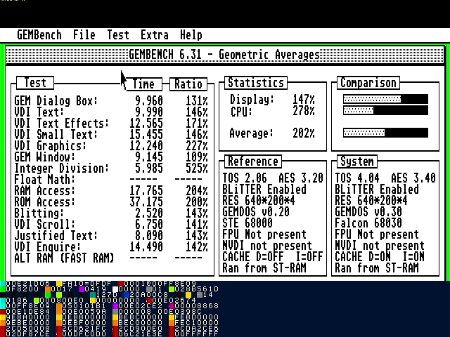

# FalconFPGA

> The previous front page, written around the ST/STE test bed, is kept as a record:
> [ST core front page (archive)](docs/README_ST_core_archive.md).

This project is a recreation of the Atari Falcon home computer, running on a small FPGA board
(a Sipeed Tang Console 138K). An FPGA is a chip you can rewire by loading a file into it. Here,
that file turns the board into a Falcon.

You can boot the original Atari operating system (TOS 4.04), use the GEM desktop, plug in a USB
keyboard and mouse, and run period software from a floppy image on an SD card. The picture comes
out over HDMI.

This is a personal workbench, not a finished product. Please read [This is not a product](#this-is-not-a-product)
before you buy any hardware because of this repository. Please also read the [Credits](#credits):
this work stands on cores and tools written by other people.

**Where it stands (26 Nov 2026).** TOS 4.04 boots to the desktop. Keyboard, mouse, floppy images and
HDMI video work. Usual tests such as GEMBENCH and FrontBench run. The processor's instruction cache
is on, and so is its full data cache (TOS in ROM and the computer's main memory), with write-allocate
as on a real Falcon. The memory chips now run at 80 MHz (build S8f, in flash 0). Next are the
missing screen modes, which needed the faster memory. Sound, hard disk and the Falcon's DSP chip are not ready yet.

The live source is on the [`falcon`](https://github.com/dave-1024/falconfpga/tree/falcon) branch.
A step-by-step guide to building and flashing it is in
[Falcon030_rtl/BUILD.md](https://github.com/dave-1024/falconfpga/blob/falcon/Falcon030_rtl/BUILD.md).
More technical status is in the
[Falcon README](https://github.com/dave-1024/falconfpga/blob/falcon/Falcon030_rtl/README.md).
This GitHub repository's default branch is `main`; clone or check out `falcon` for the live source.

> **Build only with Gowin EDA V1.9.12.03.** A later version (V1.9.12.04) has been seen to give a
> black screen with no picture, even when the build itself succeeds. Thanks to **Łukasz Jokiel**
> for finding and reporting this. The same problem was also reported for the stock MiSTeryNano and
> NanoMig cores. Details are in the [build guide](https://github.com/dave-1024/falconfpga/blob/falcon/Falcon030_rtl/BUILD.md).

## Screenshots



GEMBENCH 6.31 in ST medium on build S8 (the first 80 MHz memory build; the S8f build in flash 0 has
the same memory controller): Display 147%, CPU 278%, average 202%. The previous build, C5, scored
120%, 237% and 169%.

## What works

- **TOS 4.04** boots to the GEM desktop. You put the TOS image on the SD card (as `TOS404.IMG`).
  It is not stored in the board's flash, and it is not in this repository; you supply your own copy.
- A **USB keyboard and mouse**, the on-screen menu, and **floppy disk images** from the SD card.
- **HDMI** picture at 640x480, 60 times a second, so ordinary monitors can display it. The core
  can run in Falcon **VGA 60 Hz** or **RGB 50 Hz** timing. The default is VGA. You can switch to
  RGB from the on-screen menu (Settings > Monitor). An occasional torn frame is accepted.
- **14 MB** of the Falcon's main memory (ST-RAM). The extra "fast RAM" from the earlier ST test bed
  is not part of this Falcon build.
- The **blitter** (a chip that draws blocks of graphics), the floppy drive, the keyboard, and the
  clock/settings memory (NVRAM).
- **The processor's instruction cache** is on, for both TOS in ROM and programs in main memory.
- **The data cache** is on for TOS in ROM and for the computer's main memory, with write-allocate
  (the same setting a real Falcon uses).
- **80 MHz memory.** The memory chips (the Tang SDRAM module) run at 80 MHz instead of 32 MHz.
- **GEMBENCH** and **FrontBench** both run. Measured on build S8 (80 MHz memory), GEMBENCH 6.31
  in ST medium scored Display 147%, CPU 278% and an average of 202% (compared with a blitter STE;
  C5 scored 120/237/169). FrontBench's lastcount on S8 was 1612 (C5 1317 in the same set-up). More detail is in the
  [Falcon README](https://github.com/dave-1024/falconfpga/blob/falcon/Falcon030_rtl/README.md).

The processor runs at 16 MHz. The long-term aim is that each instruction takes the same number of
clock ticks as a real 68030. Where an exact match is not possible, slightly faster is preferred to
slower. The detailed timing list is in the Falcon README.

## What doesn't work (yet)

Parts of the Falcon that are not finished:

- **Sound.** The old ST sound chip (YM2149 / PSG) is not wired up yet. The Falcon's own DMA sound
  and codec are not wired up either.
- **Hard disk.** SCSI-2 and IDE are only placeholders. They will be new work.
- **The DSP** (the Falcon's digital signal processor). Only a placeholder is there.
- **EmuTOS** (the free replacement for TOS) has not been tried on this Falcon build.

**Screen modes.** The memory that holds the screen is not yet fast enough for the heavier Falcon
video modes. A 640-pixel-wide line in 256 colours still takes longer to fetch than one HDMI line,
so those wider 256-colour modes, and other high-colour, true-colour and larger-resolution modes,
are not reliable yet. This is why [faster memory](#planned) is planned. Separately, in RGB modes
taller than 240 lines (interlaced 400 or 480 lines) the picture drifts slowly up or down
the screen, because they do not use the native-time frame buffer.

Open problems still carried over from the earlier work:

- **Writing to the SD card can go wrong.** Copying from a floppy image to a hard disk image has
  failed after about one file, and a floppy image was once found with the wrong data written into
  it. Reading is fine. Keep backups, and do not trust data written to images yet.
- **Uploading files** to the SD card over the helper's serial link can fail until a half-finished
  transfer is closed. That transfer path has been flaky.
- A few **processor bugs** are still open (rare crash reports, a trace mode that can loop, and a
  serial-port stall after one kind of blitter operation). Details are in the Falcon README.
- There is **no maths co-processor (FPU)**. A real stock Falcon has none either.

There is still a debug overlay on the picture, and a few small video blemishes (listed in the
Falcon README).

## Planned

This is a map of the work, not a timetable. Next:

1. **Heavier screen modes** on the faster (80 MHz) memory, see
   [What doesn't work (yet)](#what-doesnt-work-yet). An S8 bomb seen once on the first boot after
   writing it to flash is being checked.
2. **Make the processor as fast as a real 68030.** A long list of instruction timings is still a
   little slower than Motorola's manual. The list, and the order of work, is in the
   [Falcon README](https://github.com/dave-1024/falconfpga/blob/falcon/Falcon030_rtl/README.md#planned).
3. **A full-height picture buffer so tall RGB modes stop drifting,** using the board's
   DDR3 memory (keeping the FPGA's block RAM free for the DSP).
4. **The rest of the Falcon chipset:** the YM2149 sound chip, then DMA sound and the codec, then
   SCSI-2 and IDE, then the DSP.
5. **A cleanup of the helper** (the small program that looks after the SD card, the menu, and the
   keyboard). That work has not started yet. The helper already on the board is left as it is
   until then.

Later: trying EmuTOS, taking the debug overlay off the picture, and using NetBSD as another
processor test.

## What you need, and how to build it

You need a Sipeed Tang Console with the 138K module, one Tang SDRAM module in slot J9, a microSD
card, an HDMI screen, and a USB keyboard and mouse. You also need your own TOS 4.04 image, and
Gowin EDA version V1.9.12.03 to build the design. There are no ready-made board files in this
repository.

The step-by-step guide — what to install, how to build the FPGA design, how to build the helper,
how to flash the board, and how to set up the SD card — is:

**[Falcon030_rtl/BUILD.md](https://github.com/dave-1024/falconfpga/blob/falcon/Falcon030_rtl/BUILD.md)**

```
git clone -b falcon https://github.com/dave-1024/falconfpga.git
cd falconfpga
```

Then follow that guide. Never use a bulk erase, and never reflash the board's BL616 USB chip.

The ST/STE core in `Atarist_030_wip/` is retired for now. Its old front page is the
[archive](docs/README_ST_core_archive.md).

## Glossary

- **FPGA**: a chip you can rewire by loading a file (a **bitstream**) into it. Here it becomes an Atari.
- **Atari ST / STE / TT / Falcon**: Atari home computers. The ST and STE used a 68000 processor.
  The TT and the Falcon (1992) used a 68030.
- **TOS**: the Atari operating system, with the GEM desktop. **EmuTOS** is a free replacement.
- **Cache**: a small fast memory inside the processor that keeps recently used code and data.
- **Blitter**: a chip that copies and draws blocks of graphics so the processor does not have to.
- **VIDEL**: the Falcon's video chip.
- **DSP**: the Falcon's digital signal processor, used for sound and heavy maths.
- **Helper**: a small extra processor on the board. It looks after the SD card, floppy images,
  USB keyboard and mouse, and the on-screen menu.
- **GEMBENCH / FrontBench**: well-known Atari speed tests.

## Credits

**Please take a moment to read this section.** None of this would exist
without the people below. They wrote the cores, designs and tools that this
bench is built from, and they deserve full credit for that work. Licences stay
in `NOTICE.md` and in their files. Nothing here assigns their work to David.

- **Wolfgang Foerster** (Inventronik): wf68k30L, the 68030 core this project started from
- **Stephen J. Leary** (TerribleFire): the TF534 accelerator, whose bus design the 68030-to-ST bridge in `Atarist_030_wip/` is modelled on. This phase of the work would have been much more difficult without him. See the credits at the top of `Atarist_030_wip/README.md`.
- **Karl Stenerud**: Musashi, the hybrid guest CPU
- **Jorge Cwik**: fx68k, the 68000 in MiSTeryNano
- **Till Harbaum** and **MiSTle-Dev**: MiSTeryNano and FPGA-Companion on the Tang boards
- **György Szombathelyi** (gyurco) and the MiSTery authors: the STE FPGA core the Nano ports come from
- **José Tejada** (jotego): JT49, the YM2149 sound chip
- **Sameer Puri**: hdl-util/hdmi, the HDMI/DVI encoder
- **The EmuTOS developers**: the optional GPL TOS image
- **The Hatari developers**: the hybrid debug method (state saves and disassembly)
- **Individual Computers**: the ACA1230-55N used as the real-030 instruction oracle
- **exxos**: GEMBENCH and the ST536 TOS 2.06 images used as test references
- **agranlund**: `tftools` (fastram, maprom, blitfix) referenced for the ST536/TF536 TOS notes
- **Łukasz Jokiel**: bug testing on his own Tang Console 138K, finding that Gowin V1.9.12.04 builds give no HDMI sync,
  finding the bug where the TOS 2.06 menu bar text was squashed up (stacked), and finding that unpacking
  the Andes toolchain with Midnight Commander corrupts it (`Bad fd number`; use `tar xf`)

If a name is missing or something is credited wrongly, please say so and it
will be fixed.

## Licence

Original work is GPL-3.0-or-later ([`LICENSE`](LICENSE), [`LICENSE-ORIGINAL.md`](LICENSE-ORIGINAL.md)). Third-party
parts keep their own licences (CERN OHL v1.2, GPL-2, MIT-style and others); the map is [`NOTICE.md`](NOTICE.md) and
the header in each file wins.

## Repository layout

| Path | What it is |
|---|---|
| [`Falcon030_rtl/`](https://github.com/dave-1024/falconfpga/tree/falcon/Falcon030_rtl) | **The live Falcon core** (branch `falcon`). See its [README](https://github.com/dave-1024/falconfpga/blob/falcon/Falcon030_rtl/README.md) and [BUILD.md](https://github.com/dave-1024/falconfpga/blob/falcon/Falcon030_rtl/BUILD.md). On `main` this folder is only a placeholder. |
| [`Atarist_030_wip/`](Atarist_030_wip/) | The ST/STE 68030 core. **Retired for now.** Status in its [README](Atarist_030_wip/README.md). Old front page: [archive](docs/README_ST_core_archive.md). |
| [`docs/`](docs/) | Project-wide docs ([index](docs/README.md)), images, and the [ST front-page archive](docs/README_ST_core_archive.md). |
| [`reference/`](reference/) | Older trees kept for comparison ([what each is for](reference/README.md)). |
| [`handoff/`](handoff/) | Engineering notes. |
| [`tools/`](tools/) | Small board scripts. |
| `LICENSE`, `NOTICE.md`, `LICENSE-ORIGINAL.md` | Licences. |

---

## Background and project history

### This is not a product

**Read this before you buy a Tang Console, an SDRAM module, or anything else because of this repository.**

This is a **personal workbench**, published so other people can follow along if they want to. It is not a product. It is not a promise of a product. It is not a promise that a Falcon, an ST desktop, or any particular game will ever work on your board.

- Do **not** buy hardware expecting a finished core you can plug in and use.
- David will **not** provide technical support to get “X” working on your machine.
- Issues, mail, and “it doesn’t boot” tickets are not a support channel.
- Dates, checklists, and “where it is headed” are a map of *this* bench. They are not a delivery schedule.

If you clone this anyway, you are on your own — same as any other public FPGA notebook.

### AI assistance

This bench is **one person**. An AI assistant is used for engineering help: HDL drafts and review, documentation, and git plumbing. That is how a single workbench produces this much writing.

It does not replace the board, the real 68030, or the decision of what is known-good. Silicon results and the instruction audit are David’s. Commit volume is not a team. The cores listed under Credits were written by the people named there, not by the assistant.

### Toolchain

Build with Gowin EDA **V1.9.12.03** only. V1.9.12.04 has been seen to produce a black screen. Details, and how to build the helper, are in the [build guide](https://github.com/dave-1024/falconfpga/blob/falcon/Falcon030_rtl/BUILD.md). This repository is source only: board files, ROMs and disk images stay on the machine that built or flashed them.

### The CPU

The guest CPU started from the public **wf68k30L** core. That stock core was **heavily re-engineered** here — initialisers, exception frames, MOVEM/abort, NBCD, RTD, SFC/DFC reset, and a pile of smaller bus and privilege fixes. It was also **heavily audited for CPU instruction errors** against a real 68030 (an Amiga A1200 with an ACA1230-55N): opcode by opcode, including cases where the tests passed and the silicon still disagreed. It is not a Musashi rewrite and it is not fx68k. Change history: [`Atarist_030_wip/docs/HISTORY.md`](Atarist_030_wip/docs/HISTORY.md); lessons and every bug found: [`Atarist_030_wip/docs/FALCON_LESSONS.md`](Atarist_030_wip/docs/FALCON_LESSONS.md), with a living copy (including later Falcon findings) in [`Falcon030_rtl/docs/FALCON_LESSONS.md`](https://github.com/dave-1024/falconfpga/blob/falcon/Falcon030_rtl/docs/FALCON_LESSONS.md). The Falcon build keeps its own copy of this core in `Falcon030_rtl/hdl/cpu030/`.

### Why an STE first, before the Falcon?

The Falcon's DSP and its other chips expect the 68030 to behave exactly like the real one, down to the clock cycle. Getting that right is easier on a simpler, well-understood machine first. The Atari ST/STE was that machine: there is a proven open-source ST/STE core to build on (MiSTeryNano), lots of known software and benchmarks to test against, and real STEs and 68030 accelerator boards (TerribleFire) to compare with. So the 68030 was first made cycle-exact on the ST bus, as a test bed. The same CPU now lives on the Falcon core. That ST core is retired for now.

### Where it started

The project began as a **hybrid scaffold**: fabric on the FPGA plus C modules on the board’s **Andes AE350** RISC-V processor. The guest CPU in that scaffold was **Musashi**. That hybrid was accurate enough to:

- boot **Atari TOS 4.04** from an SD image the user supplies
- run ST games on the Falcon model (Robocop, Treasure Island Dizzy, Frontier) through a GAMEX wrapper
- accept Atari legacy HD tools and GEM partitions on IDE images
- survive a 36-hour POV-Ray soak whose output file matched the same POV-Ray version on a real Atari STE

Archive: **`reference/Hybrid030/`**. Compile notes: `reference/Hybrid030/hybrid_musashi/FIRST_TIME.md`. Do not install AndeSight. **No Tang SDRAM module** is used by that tree.

**GUI build of that HDL fails until two boxes are ticked.** Configuration → Place & Route → Dual-Purpose Pin: tick **Use MSPI as regular IO** and **Use CPU as regular IO**. Leave JTAG, SSPI, READY and DONE unticked. Steps: [`reference/Hybrid030/hybrid_falcon030/GUI.md`](reference/Hybrid030/hybrid_falcon030/GUI.md). The CLI script `build_hybrid.tcl` sets them.

### SOM DDR3 — faults that were not published

These are not bugs in the HDL in this repo. They are faults in the **Gowin DDR3 IP** on this 138K SOM, used with the Andes AE350. They were measured here in July 2026.

As of September 2026 they were not in Gowin's IP notes, not in Sipeed's board documentation, and not in Sipeed's public repositories. They were not found described anywhere else on the public web either. They are written here so the next person does not have to discover them the same way.

- Shared DDR3 **write lane 4** never completes. `wr_done` does not arrive, including on an isolated copy of the vendor example. Tied off 14 July 2026. `falcon_wprobe` returned nothing.
- The **upper half of a 64-bit DDR3 read** is dead. Measured 11 July 2026: `fb_base` latched address-independent garbage while `magic[31:0]` validated. Lanes were cut from 64-bit to 32-bit. 32-bit is the width Gowin's own `DDR3_Shared` example validates.
- The **upper 32 bits of Extended AHB `HWDATA`** are dead. 32-bit transfers, even-word addresses, payload at +0 and +8. A write at +4 does not land.

There is no published workaround. Using the IP as documented does not work for those lanes. This project did not fix the IP. It stopped using the dead parts. A real fix is to **write your own DDR3 controller** instead of the Gowin IP, or wait until Gowin learns of the faults and ships an updated IP. No such update existed when this was written.

These faults do **not** apply to `reference/misterynano_tc138k/` or `reference/rigsdram/`. Those trees do not use this IP. The write-up is [`Hybrid030/AE350_ERRATA.md`](reference/Hybrid030/AE350_ERRATA.md). The live Falcon and ST cores use the external SDRAM module in J9, not this DDR3 IP.

### Reference trees

Kept as references; they do not share a top. See [`reference/README.md`](reference/README.md).

#### `reference/rigsdram/` — 030 + external SDRAM oracle

The re-engineered wf68k30L plus a guest image that walks T0–T11 (BSRAM through vectors, including a 32 MB march). Last cold-and-warm silicon that is treated as known-good printed:

```
12345
RIGSDRAM GUEST
IMG=74D8E373
T0–T11 PASS
DONE P
```

`12345` is the healthy UART signature. `112345` only means the AUTO_WARM broker pulse fired late. PnR uses **Replicate Resources = TRUE**. CPU target is **16 MHz**; current Fmax on that tree is above that.

The instruction audit was run against a real **68030 in an Amiga A1200 + ACA1230-55N**. The A1200 overturned more than one paper argument about `$A`/`$B` boundaries — F38 looked fine in tests and was still wrong. That machine is the oracle for CPU behaviour. Do not drop a fresh upstream wf68k30L on top of this tree and expect the same results.

**Needs the Tang SDRAM module in J9.** Do not flash this bitstream with the socket empty.

#### `reference/misterynano_tc138k/` — stock ST desktop on this board

Console-138K-only cut of [MiSTeryNano](https://github.com/MiSTle-Dev/MiSTeryNano) (upstream snapshot `c8e4601`). CPU here is still **fx68k** (68000). Build with `gw_sh build_tc138k.tcl` from that folder (Version C, JTAG-as-GPIO). This tree is **not yet a proven desktop on David’s Console**. Do not splice the 030 into this folder. Do not flash it with J9 empty.

### Where it is headed

1. ~~An ST/STE test bed with a 68030, caches, TT-RAM and the PMMU~~ (done, October 2026).
2. **Now:** the Falcon core (TOS 4.04 desktop is up). The instruction cache and the full data cache (ROM and main memory, with write-allocate) are on. The memory now runs at 80 MHz. Next are the remaining screen modes, then the remaining 68030 timing work, the rest of the Falcon chipset and the helper cleanup. See [Planned](#planned).

### Methods

- **Silicon first.** A passing build log is not a passing board.
- **Instruction audit against a real 030** (A1200 + ACA1230-55N). Tests that pass can still be wrong; the Amiga was allowed to overrule them.
- **Gowin on this SOM:** device Version **C**.
- **No double-reset as a product.** AUTO_WARM is a board workaround, not a core fix.

### Hardware notes

- The **Tang SDRAM module** is the plug-in board in **J9**, not the DDR3 soldered on the 138K module. The Falcon core, the retired ST core, and the reference trees `rigsdram` and `misterynano_tc138k` all need it; only `reference/Hybrid030/` does not.
- The Falcon and ST cores use a helper program on the board's AE350. Falcon helper source is copied in `Falcon030_rtl/helper/`. The BL616 stays the USB JTAG/serial bridge and is never reflashed.
- Flash map for the **Falcon** core: the FPGA design goes at address 0. TOS 4.04 comes from the SD card. The helper already on the board sits at 0x600000. See the [build guide](https://github.com/dave-1024/falconfpga/blob/falcon/Falcon030_rtl/BUILD.md).
- Flash map for the retired **ST** core: FPGA design at 0, TOS at 0x500000, helper at 0x600000.
