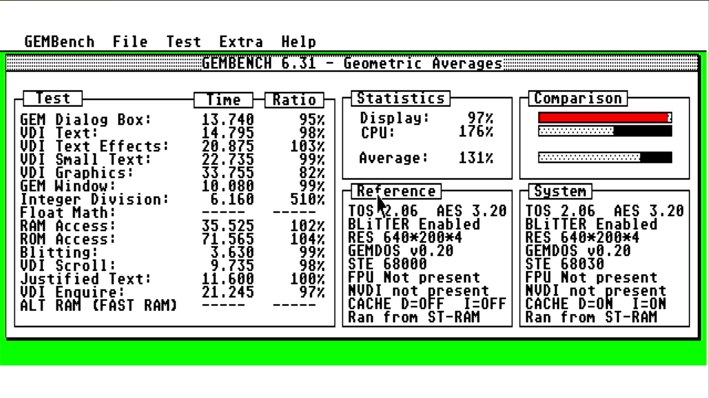
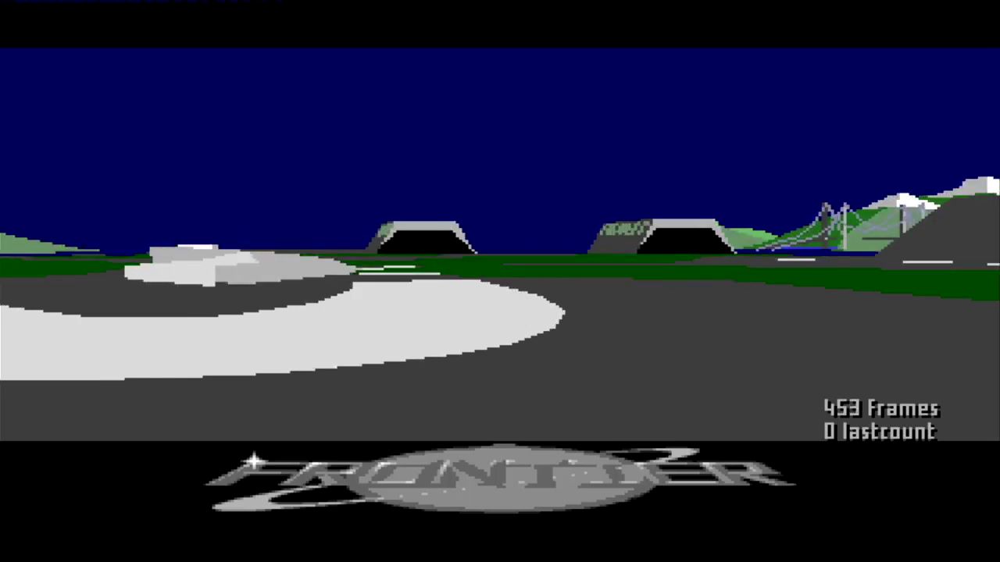

# FalconFPGA

**An Atari ST with a 68030 processor, rebuilt inside an FPGA chip, on a small Sipeed Tang Console 138K board.**
The goal is a cycle-exact 68030 (it should run every instruction in the same number of clock cycles as the real
chip), and later a full **Atari Falcon** with its DSP56001 sound/signal processor.

> **Please read the [Credits](#credits).** This project stands on the work of other people: the CPU cores, the
> Atari ST core, the TerribleFire bus design and more. If you use, share or build on anything here, please keep
> their names with it.

> **This is a personal workbench, not a product.** No support, no promises, no release dates. Please read
> [This is not a product](#this-is-not-a-product) before you buy any hardware because of this repository.

## The blitter, TT-RAM and BLITFIX: correct behaviour, not a fault

If you run TOS 2.06 on this core and switch the blitter on, you also need BLITFIX. This is how a real Atari with a
68030 and extra memory behaves too. It is not a fault in the core.

### Why the blitter starts switched off
The **blitter** is a helper chip in the STE that copies blocks of screen graphics so the main processor does not
have to. When TOS 2.06 finds a 68030 processor, it leaves the blitter switched off on purpose. It does exactly the
same on real 68030 hardware: the Options menu shows "Cache" where "Blitter" would normally be. To use the blitter,
switch it on with the small program **BLITON**.

### Why BLITFIX is needed when the blitter is on
**TT-RAM** is extra, faster memory that only the 68030 processor can use. The blitter can only reach the ST's own
memory (ST-RAM). A real Mega STE or TT with fast memory has exactly the same limit. TOS 2.06 does not know about this
limit. So when the blitter is on and a program sits in TT-RAM, TOS can ask the blitter to copy memory it cannot
reach, and you get crashes or bombs on screen.

**BLITFIX** is a free tool by agranlund (also used on real accelerated STs). It makes TOS do those copies with the
processor instead of the blitter. This is the standard fix on real hardware, not a hack for this core.

### Why there is a TT-RAM driver
TOS 2.06 does not know that TT-RAM exists, so on its own it never uses it. The small program **TTRAM.PRG** tells TOS
the memory is there. On real hardware a driver program does the same job.

### How to use it
Use the ready-made floppy image [`tools/blitfix/blitfix.st`](tools/blitfix/blitfix.st). Its AUTO folder runs these
programs at start-up, in this order: **TTRAM**, then **BLITON**, then **BLITFIX**. (The AUTO folder is where TOS looks
for programs to start automatically at boot.) It also has a test program, BFTEST. Details:
[`tools/blitfix/README.md`](tools/blitfix/README.md).

GEMBENCH and most older programs still load into ST-RAM unless they are marked to use TT-RAM. GEMBENCH's own
screen says "Ran from ST-RAM".




*Real capture from the actual device: a Tang Console 138K running the 68030 STE core, grabbed from its HDMI output.
GEMBENCH 6.31 under TOS 2.06 (ST Medium, STE 68000 reference, I and D caches on, run from ST-RAM): CPU 182%,
integer division 510%, TT-RAM (ALT RAM) access 206%. The display tests are low because the blitter was not enabled
for this run, so the overall average is 91%.*



*Real capture from the actual device: a Tang Console 138K running the 68030 STE core, grabbed from its HDMI output.
FrontBench (`FRNTBNCH.PRG`, the Frontier: Elite 2 intro benchmark), 23 Oct 2026.*

## Why an STE first, before the Falcon?
The Falcon's DSP56001 and its other chips expect the 68030 to behave exactly like the real one, down to the clock
cycle. Getting that right is easier on a simpler, well-understood machine first. The Atari ST/STE is that machine:
there is a proven open-source ST/STE core to build on (MiSTeryNano), lots of known software and benchmarks to test
against (TOS 2.06, EmuTOS, GEMBench), and real STEs and 68030 accelerator boards (TerribleFire) to compare with. So the
68030 is first made cycle-exact on the ST bus, as a test bed; then the same CPU moves onto Falcon hardware.

## What works now (23 Oct 2026)
- Boots **TOS 2.06** and **EmuTOS** to the GEM desktop, low and medium resolution, 4 MB ST-RAM.
- A 68030 CPU with its **instruction and data caches**, plus **16 MB of TT-RAM** (fast RAM only the 68030 sees),
  both on by default. GEMBench: about 132% of a stock STE.
- Floppy images from an **SD card**, including saving from the desktop; **USB keyboard and mouse**; an on-screen
  menu (OSD), all run by a small helper processor (the AE350) on the same chip.
- HDMI/DVI video out.

## What doesn't work yet
- TOS 2.06 with TT-RAM: black screen after a **cold power-up** (a warm reset is fine; EmuTOS is fine).
- The **blitter** is found by TOS 2.06 but left off by default, as on a real 68030 machine. Switched on (BLITON) it
  now works: the TOS scroll hang is fixed (PR #15) and GEMBENCH 6.31 gives 131% with it on. The blitter cannot reach
  TT-RAM (24-bit ST bus), so blits from TT-RAM need a software fallback (BLITFIX). EmuTOS does not detect it when TT-RAM is fitted.
- The serial port can stall after one kind of blitter operation.
- No **PMMU** yet (work starts 26 Oct 2026). No Falcon hardware yet (VIDEL video, DSP, IDE).
- Full list, in order: [`Atarist_030_wip/docs/TODO.md`](Atarist_030_wip/docs/TODO.md);
  bugs in plain English: [`docs/BUGS.md`](docs/BUGS.md); TOS versions: [`docs/TOS_COMPAT.md`](docs/TOS_COMPAT.md).

## What you need
- A **Sipeed Tang Console** with the **138K** module (GW5AST-LV138PG484AC1/I0, device version C).
- **One Tang SDRAM module** in slot **J9** (ST-RAM and TT-RAM share it). Never flash with J9 empty.
- A microSD card (FAT) with `.st` floppy images, an HDMI screen, a USB keyboard and mouse.
- Your own **TOS** image (TOS 2.06 or EmuTOS). Atari TOS is not in this repository.
- **Gowin EDA V1.9.12.03** (Windows or Linux) to build, and for the helper firmware the Andes AST v5.1.1 toolchain.
  No ready-made bitstreams are published: this repository is source only.

## How to try it
1. Build the core: `cd Atarist_030_wip` then `gw_sh build_st_helper.tcl`.
2. Build the helper firmware: `Atarist_030_wip/helper_fw/companion/build_companion.sh`.
3. Flash with Gowin's `programmer_cli`: core at 0, TOS at 0x500000, helper at 0x600000. Put floppy images on the SD card.

Step by step, in plain words: [`docs/HOWTO_BUILD.md`](docs/HOWTO_BUILD.md). Engineer's version (switches, flash
map, rules): [`Atarist_030_wip/docs/BUILD.md`](Atarist_030_wip/docs/BUILD.md). All docs: [`docs/README.md`](docs/README.md).

## Glossary
- **FPGA**: a chip that can be rewired by loading a file (a **bitstream**, `.fs`) into it. Here it becomes an Atari.
- **Atari ST / STE / TT / Falcon**: Atari home computers. ST (1985) and STE (1989) use a 68000; TT (1990) and Falcon
  (1992) use a 68030.
- **68000 / 68030**: Motorola processors. The 68030 is a faster, 32-bit successor with caches and a PMMU.
- **TOS**: the Atari operating system (with the GEM desktop). **EmuTOS** is a free, open-source replacement.
- **Cache**: a small fast memory inside the CPU that keeps recently used code and data.
- **TT-RAM**: extra fast memory that only the 68030 uses (named after the Atari TT); the chipset can't see it.
- **Blitter**: a chip in the STE that copies and draws blocks of graphics without the CPU.
- **PMMU**: the 68030's memory management unit (address translation, memory protection, cache control per area).
- **DSP56001**: the Falcon's digital signal processor (sound and maths).
- **AE350 helper**: a small RISC-V processor built into the board's chip; here it handles the SD card, floppy images,
  USB keyboard/mouse and the on-screen menu.
- **GEMBench / GEMBENCH**: Atari benchmark programs; results are a percentage of a real machine.
- **Cycle-exact**: every instruction takes the same number of clock cycles, and bus accesses happen at the same
  points, as on the real chip.

## Credits

**Please take a moment to read this section.** None of this would exist
without the people below. They wrote the cores, designs and tools that this
bench is built from, and they deserve full credit for that work. Licences stay
in `NOTICE.md` and in their files. Nothing here assigns their work to David.

- **Wolfgang Foerster** (Inventronik): wf68k30L, the 68030 core this project started from
- **Stephen J. Leary** (TerribleFire): the TF534 accelerator, whose bus design the 68030-to-ST bridge in `Atarist_030_wip/` is modelled on. This phase of the work would have been much more difficult without him. See the credits at the top of `Atarist_030_wip/README.md`.
- **Karl Stenerud**: Musashi, the hybrid guest CPU
- **Jorge Cwik**: fx68k, the 68000 in MiSTeryNano
- **Till Harbaum** and **MiSTle-Dev**: MiSTeryNano and FPGA-Companion on the Tang boards
- **György Szombathelyi** (gyurco) and the MiSTery authors: the STE FPGA core the Nano ports come from
- **José Tejada** (jotego): JT49, the YM2149 sound chip
- **Sameer Puri**: hdl-util/hdmi, the HDMI/DVI encoder
- **The EmuTOS developers**: the optional GPL TOS image
- **The Hatari developers**: the hybrid debug method (state saves and disassembly)
- **Individual Computers**: the ACA1230-55N used as the real-030 instruction oracle
- **exxos**: GEMBENCH and the ST536 TOS 2.06 images used as test references
- **agranlund**: `tftools` (fastram, maprom, blitfix) referenced for the ST536/TF536 TOS notes

If a name is missing or something is credited wrongly, please say so and it
will be fixed.

## Licence
Original work is GPL-3.0-or-later ([`LICENSE`](LICENSE), [`LICENSE-ORIGINAL.md`](LICENSE-ORIGINAL.md)). Third-party
parts keep their own licences (CERN OHL v1.2, GPL-2, MIT-style and others); the map is [`NOTICE.md`](NOTICE.md) and
the header in each file wins.

## Repository layout
| Path | What it is |
|---|---|
| [`Atarist_030_wip/`](Atarist_030_wip/) | **The live core:** ST(E) with the 68030 in place of the 68000 via a TF534-style bridge, AE350 helper. Main build `build_st_helper.tcl`; `debug_builds/`, `build_legacy/`; design docs in `docs/`; status in its [README](Atarist_030_wip/README.md). |
| [`docs/`](docs/) | Project-wide docs ([index](docs/README.md)), images, and [`history/`](docs/history/README.md) (old workflow files, handovers, patches, investigations). |
| [`reference/`](reference/) | Older trees kept for comparison: `rigsdram/`, `misterynano_tc138k/`, `Hybrid030/` ([what each is for](reference/README.md)). |
| [`handoff/`](handoff/) | Current engineering state and next steps ([`handoff/CONTEXT.md`](handoff/CONTEXT.md)). |
| [`tools/`](tools/) | Small board scripts (helper console `hc.sh`, uploader `up2.py`). |
| `CONTEXT.md` | Short briefing used to catch up after a break. |
| `LICENSE`, `NOTICE.md`, `LICENSE-ORIGINAL.md` | Licences. |

---

## Background and project history

### This is not a product

**Read this before you buy a Tang Console, an SDRAM module, or anything else because of this repository.**

This is a **personal workbench**, published so other people can follow along if they want to. It is not a product. It is not a promise of a product. It is not a promise that a Falcon, an ST desktop, or any particular game will ever work on your board.

- Do **not** buy hardware expecting a finished core you can plug in and use.
- David will **not** provide technical support to get “X” working on your machine.
- Issues, mail, and “it doesn’t boot” tickets are not a support channel.
- Dates, checklists, and “where it is headed” are a map of *this* bench. They are not a delivery schedule.

If you clone this anyway, you are on your own — same as any other public FPGA notebook.

### AI assistance

This bench is **one person**. An AI assistant is used for engineering help: HDL drafts and review, documentation, and git plumbing. That is how a single workbench produces this much writing.

It does not replace the board, the real 68030, or the decision of what is known-good. Silicon results and the instruction audit are David’s. Commit volume is not a team. The cores listed under Credits were written by the people named there, not by the assistant.

### Toolchain
Gowin IDE / gw_sh **V1.9.12.03** on Windows or headless Linux (same results), device **Version C**. The AE350 helper
firmware builds with **Andes AST v5.1.1** and the BSP from Gowin's **RiscV_AE350_SOC_V1.3**. This repository is
**source only**: bitstreams, `impl/`, ROMs and disk images stay on the machine that built or flashed them.

### The CPU
The guest CPU started from the public **wf68k30L** core. That stock core was **heavily re-engineered** here — initialisers, exception frames, MOVEM/abort, NBCD, RTD, SFC/DFC reset, and a pile of smaller bus and privilege fixes. It was also **heavily audited for CPU instruction errors** against a real 68030 (an Amiga A1200 with an ACA1230-55N): opcode by opcode, including cases where the tests passed and the silicon still disagreed. It is not a Musashi rewrite and it is not fx68k. Change history: [`Atarist_030_wip/docs/HISTORY.md`](Atarist_030_wip/docs/HISTORY.md); lessons and every bug found: [`Atarist_030_wip/docs/FALCON_LESSONS.md`](Atarist_030_wip/docs/FALCON_LESSONS.md).

### Where it started

The project began as a **hybrid scaffold**: HDL fabric plus C modules on the SOM’s **Andes AE350** RISC-V. The guest CPU in that scaffold was **Musashi**. That hybrid was accurate enough to:

- boot **Atari TOS 4.04** from an SD image the user supplies (that became the default guest TOS; EmuTOS was not the only target)
- run ST games on the Falcon model (Robocop, Treasure Island Dizzy, Frontier) through a GAMEX wrapper
- accept Atari legacy HD tools and GEM partitions on IDE images
- survive a 36-hour POV-Ray soak whose output file matched the same POV-Ray version on a real Atari STE

C was assembled with Windows batch files and `riscv32-elf-gcc`, not Andesight. Debug was Hatari state saves plus disassembly.

The hybrid exists to **move modules from C to RTL one at a time**, not as the finished machine.

Archive: **`reference/Hybrid030/`** — `hybrid_falcon030/` (HDL) and `hybrid_musashi/` (C + bats). Compile notes: `reference/Hybrid030/hybrid_musashi/FIRST_TIME.md`. Do not install AndeSight. **No Tang SDRAM module** — see Hardware notes.

**GUI build of that HDL fails until two boxes are ticked.** Configuration → Place & Route → Dual-Purpose Pin: tick **Use MSPI as regular IO** and **Use CPU as regular IO**. Leave JTAG, SSPI, READY and DONE unticked. Steps: [`reference/Hybrid030/hybrid_falcon030/GUI.md`](reference/Hybrid030/hybrid_falcon030/GUI.md). The CLI script `build_hybrid.tcl` sets them.

### SOM DDR3 — faults that were not published

These are not bugs in the HDL in this repo. They are faults in the **Gowin DDR3 IP** on this 138K SOM, used with the Andes AE350. They were measured here in July 2026.

As of September 2026 they were not in Gowin's IP notes, not in Sipeed's board documentation, and not in Sipeed's public repositories. They were not found described anywhere else on the public web either. They are written here so the next person does not have to discover them the same way.

- Shared DDR3 **write lane 4** never completes. `wr_done` does not arrive, including on an isolated copy of the vendor example. Tied off 14 July 2026. `falcon_wprobe` returned nothing.
- The **upper half of a 64-bit DDR3 read** is dead. Measured 11 July 2026: `fb_base` latched address-independent garbage while `magic[31:0]` validated. Lanes were cut from 64-bit to 32-bit. 32-bit is the width Gowin's own `DDR3_Shared` example validates.
- The **upper 32 bits of Extended AHB `HWDATA`** are dead. 32-bit transfers, even-word addresses, payload at +0 and +8. A write at +4 does not land.

There is no published workaround. Using the IP as documented does not work for those lanes. This project did not fix the IP. It stopped using the dead parts. A real fix is to **write your own DDR3 controller** instead of the Gowin IP, or wait until Gowin learns of the faults and ships an updated IP. No such update existed when this was written.

These faults do **not** apply to `reference/misterynano_tc138k/` or `reference/rigsdram/`. Those trees do not use this IP. The original note is the revision header of the bring-up top, `ae350_stage0_top.v`. The write-up is [`Hybrid030/AE350_ERRATA.md`](reference/Hybrid030/AE350_ERRATA.md).

### Reference trees
Kept as references; they do not share a top. See [`reference/README.md`](reference/README.md).

#### `reference/rigsdram/` — 030 + external SDRAM oracle

The re-engineered wf68k30L plus a guest image that walks T0–T11 (BSRAM through vectors, including a 32 MB march). Last cold-and-warm silicon that is treated as known-good printed:

```
12345
RIGSDRAM GUEST
IMG=74D8E373
T0–T11 PASS
DONE P
```

`12345` is the healthy UART signature. `112345` only means the AUTO_WARM broker pulse fired late. PnR uses **Replicate Resources = TRUE**. CPU target is **16 MHz**; current Fmax on that tree is above that.

The instruction audit was run against a real **68030 in an Amiga A1200 + ACA1230-55N** (FIXREV14 session and the work before it). The audit was treated as complete for the scoped instruction set. The A1200 overturned more than one paper argument about `$A`/`$B` boundaries — F38 looked fine in tests and was still wrong. That machine is the oracle for CPU behaviour. Do not drop a fresh upstream wf68k30L on top of this tree and expect the same results.

Parked on this tree: a false Line-F at `$406` after a cold start; the next instrument is a pipe trace, not another reset workaround.

**Needs the Tang SDRAM module in J9.** Do not flash this bitstream with the socket empty.

#### `reference/misterynano_tc138k/` — stock ST desktop on this board

Console-138K-only cut of [MiSTeryNano](https://github.com/MiSTle-Dev/MiSTeryNano) (upstream snapshot `c8e4601`). CPU here is still **fx68k** (68000). Build with `gw_sh build_tc138k.tcl` from that folder (Version C, JTAG-as-GPIO). A one-line board fix dropped a stale `.clk` port map that upstream tc138k still carries (`20260925-mn3`). Replay `mn4` matched. Bitstream is not in git (~36.5 MB `.fs` on the build box).

This tree is **not yet a proven desktop on David’s Console**. Companion firmware, TOS in SPI flash, and the **Tang SDRAM module in J9** are still required. Do not splice the 030 into this folder. Do not flash it with J9 empty.

### Where it is headed
1. ~~Clone MiSTeryNano, splice the wf68k30L via a TF534-style bridge, 16 MHz+ CPU on the 8 MHz ST bus, AE350 helper~~ (done, October 2026); ~~caches~~, ~~TT-RAM~~ (done).
2. **Now:** finish the 030 on the ST bus ([`TODO.md`](Atarist_030_wip/docs/TODO.md)); the 68030 PMMU in HDL from 26 Oct 2026.
3. Then move the same core onto **Falcon** glue (VIDEL, IDE, DSP56001).

### Methods
- **Silicon first.** A passing Gowin log is not a passing board.
- **Instruction audit against a real 030** (A1200 + ACA1230-55N). Tests that pass can still be wrong; the Amiga was allowed to overrule them.
- **Gowin on this SOM:** device Version **C**, Replicate Resources **TRUE** when chasing Fmax.
- **No double-reset as a product.** AUTO_WARM is a board workaround, not a core fix.

### Hardware notes
- The **Tang SDRAM module** is the plug-in board in **J9**, not the DDR3 soldered on the 138K SOM. Every HDL build
  here needs it (`Atarist_030_wip/`, `reference/rigsdram/`, `reference/misterynano_tc138k/`); only
  `reference/Hybrid030/` does not.
- `Atarist_030_wip/` runs FPGA-Companion on the SOM's AE350 (source in `Atarist_030_wip/helper_fw/`); the BL616 stays
  the USB JTAG/serial bridge. Stock `reference/misterynano_tc138k/` still expects a BL616 companion, which is not in this repo.
- Flash map for `Atarist_030_wip/`: bitstream from 0 (ends ~0x4B6000), **TOS at 0x500000**, **helper at 0x600000**.
