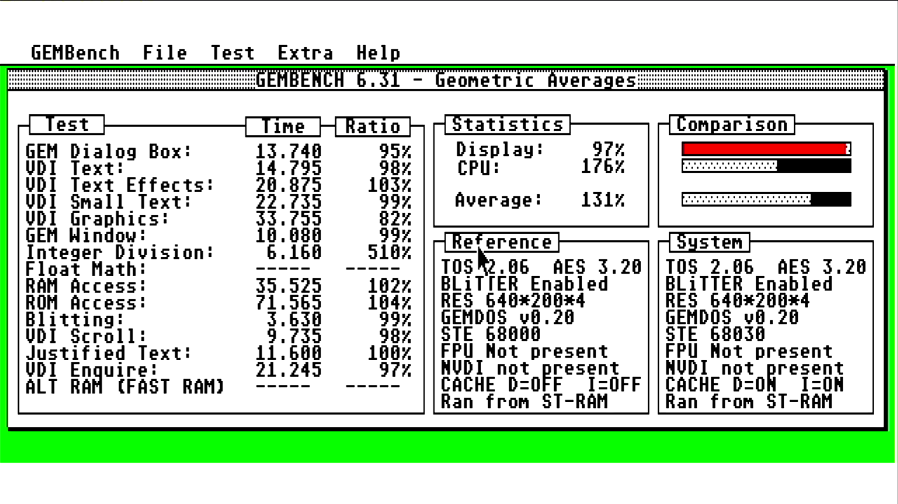
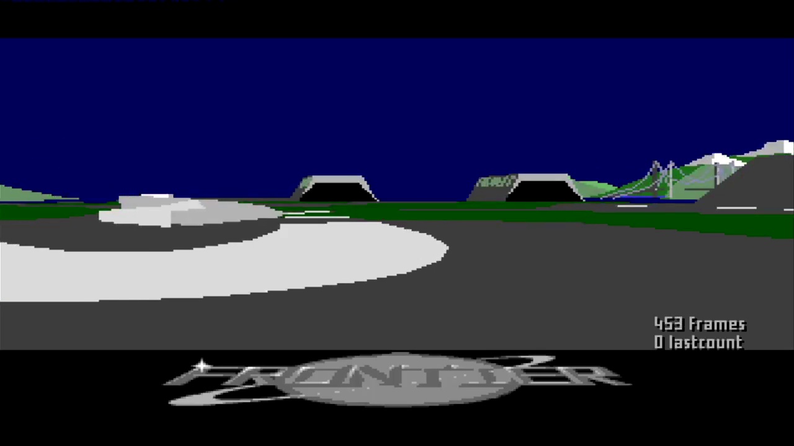
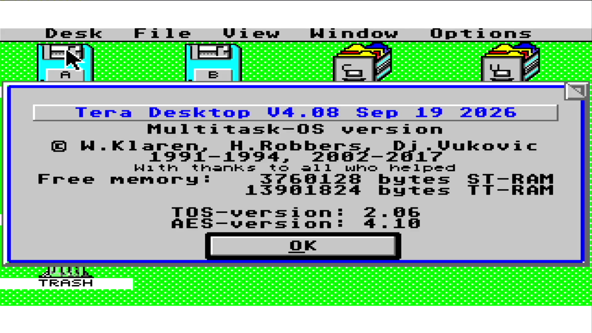
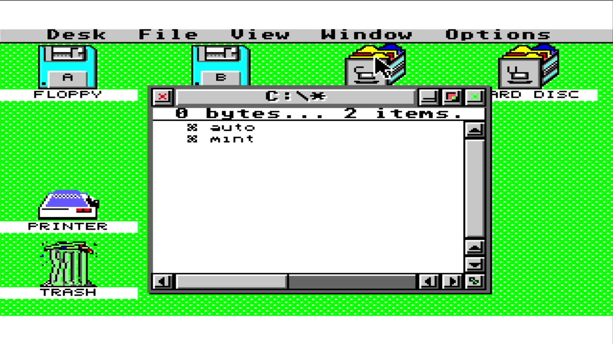

> **Archive.** This is a copy of the repository front page as it stood on 25 Nov 2026, when the live work moved to the Falcon core. The body is unchanged except that relative links have been adjusted for this folder. The current front page is the root [`README.md`](../README.md).

# FalconFPGA

**An Atari ST with a 68030 processor, rebuilt inside an FPGA chip, on a small Sipeed Tang Console 138K board.**
The goal is a cycle-exact 68030 (it should run every instruction in the same number of clock cycles as the real
chip), and later a full **Atari Falcon** with its DSP56001 sound/signal processor.

> **Please read the [Credits](#credits).** This project stands on the work of other people: the CPU cores, the
> Atari ST core, the TerribleFire bus design and more. If you use, share or build on anything here, please keep
> their names with it.

> **This is a personal workbench, not a product.** No support, no promises, no release dates. Please read
> [This is not a product](#this-is-not-a-product) before you buy any hardware because of this repository.

> **Build with Gowin EDA V1.9.12.03 (build 86714) only.** Gowin EDA **V1.9.12.04 (build 89079)** does not seem to
> produce a working bitstream for this design: it builds without errors and meets timing, but the result gives a
> black screen with no HDMI sync. On 9 Nov 2026 a V1.9.12.04 build of main `7896b55` was loaded on our board and
> stayed black, while a V1.9.12.03 build of the same commit booted straight to the GEM desktop. Settings,
> constraints and pins were identical; V1.9.12.04 synthesises and places the design differently. V1.9.12.03 is the
> version this project is developed and tested with. Thanks to **Łukasz Jokiel** for finding and reporting this.
> This is not only this project: the stock **MiSTeryNano** and **NanoMig** cores also fail on V1.9.12.04
> (reported by their developers, Nov 2026). Use V1.9.12.03.

## The blitter, TT-RAM and BLITFIX: correct behaviour, not a fault

If you run TOS 2.06 on this core and switch the blitter on, you also need BLITFIX. This is how a real Atari with a
68030 and extra memory behaves too. It is not a fault in the core.

### Why the blitter starts switched off
The **blitter** is a helper chip in the STE that copies blocks of screen graphics so the main processor does not
have to. When TOS 2.06 finds a 68030 processor, it leaves the blitter switched off on purpose. It does exactly the
same on real 68030 hardware: the Options menu shows "Cache" where "Blitter" would normally be. To use the blitter,
switch it on with the small program **BLITON**.

### Why BLITFIX is needed when the blitter is on
**TT-RAM** is extra, faster memory that only the 68030 processor can use. The blitter can only reach the ST's own
memory (ST-RAM). A real Mega STE or TT with fast memory has exactly the same limit. TOS 2.06 does not know about this
limit. So when the blitter is on and a program sits in TT-RAM, TOS can ask the blitter to copy memory it cannot
reach, and you get crashes or bombs on screen.

**BLITFIX** is a free tool by agranlund (also used on real accelerated STs). It makes TOS do those copies with the
processor instead of the blitter. This is the standard fix on real hardware, not a hack for this core.

**EmuTOS** (the free replacement for TOS) already knows about this limit. When TT-RAM is fitted it leaves the blitter
off on purpose, so it needs no BLITFIX and its Blitter menu item is simply greyed out. With EmuTOS 1.4, no blitter
when TT-RAM is fitted is normal behaviour, not a bug.

The blitfix.st floppy is safe to use with EmuTOS 1.4 too. TTRAM.PRG says "already installed", because EmuTOS finds
TT-RAM by itself. BLITON cannot switch the blitter on, because EmuTOS hides it when TT-RAM is present. BLITFIX does not
change how EmuTOS draws; it only lets programs that run in ST-RAM see the real blitter. So EmuTOS stays safe with
TT-RAM and does its own drawing without the blitter. (This comes from reading the programs' source; it has not been
tested on the board with EmuTOS yet.)

### Why there is a TT-RAM driver
TOS 2.06 does not know that TT-RAM exists, so on its own it never uses it. The small program **TTRAM.PRG** tells TOS
the memory is there. On real hardware a driver program does the same job.

### Hard disk drivers and the blitter

Some hard disk drivers can use the blitter too. HDDriver (version 11 and later) has an optional setting that uses the
blitter to speed up IDE hard disk transfers. Because the blitter cannot reach TT-RAM, that setting does not work
once TT-RAM is in use, and BLITFIX does not cover it, since BLITFIX only fixes TOS's own drawing. So with TT-RAM on,
**leave HDDriver's blitter option off**. This is the same advice owners of real accelerated STs and Falcons with fast
RAM are given ([Badwolf on exxos's forum](https://www.exxosforum.co.uk/forum/viewtopic.php?start=560&t=5934)), so it
is a limit of the original chip, not a fault in this core. HDDriver still works normally without it. Few STs have an
IDE port anyway, and some accelerator cards with their own IDE port handle fast RAM with their own hardware.

### How to use it
Use the ready-made floppy image [`tools/blitfix/blitfix.st`](../tools/blitfix/blitfix.st). Its AUTO folder runs these
programs at start-up, in this order: **TTRAM**, then **BLITON**, then **BLITFIX**. (The AUTO folder is where TOS looks
for programs to start automatically at boot.) It also has a test program, BFTEST. Details:
[`tools/blitfix/README.md`](../tools/blitfix/README.md).

GEMBENCH and most older programs still load into ST-RAM unless they are marked to use TT-RAM. GEMBENCH's own
screen says "Ran from ST-RAM".




*Real capture from the actual device: a Tang Console 138K running the 68030 STE core (current build, with the
RMC/blitter fixes), grabbed from its HDMI output. GEMBENCH 6.31 under TOS 2.06 (ST Medium, STE 68000 reference,
I and D caches on, run from ST-RAM), with the blitter switched on using BLITON: Display 97%, CPU 176%,
average 131%.*



*Real capture from the actual device: a Tang Console 138K running the 68030 STE core, grabbed from its HDMI output.
FrontBench (`FRNTBNCH.PRG`, the Frontier: Elite 2 intro benchmark), 23 Oct 2026.*

## Why an STE first, before the Falcon?
The Falcon's DSP56001 and its other chips expect the 68030 to behave exactly like the real one, down to the clock
cycle. Getting that right is easier on a simpler, well-understood machine first. The Atari ST/STE is that machine:
there is a proven open-source ST/STE core to build on (MiSTeryNano), lots of known software and benchmarks to test
against (TOS 2.06, EmuTOS, GEMBench), and real STEs and 68030 accelerator boards (TerribleFire) to compare with. So the
68030 is first made cycle-exact on the ST bus, as a test bed; then the same CPU moves onto Falcon hardware.

## What's working now (24 Nov 2026)
The current core is **F172** vC1 (speed `cf51baa`), which includes **F171** (`f6a5429`). Flash 0 still holds **F170** (`8968788`); F171 and F172 were tested from SRAM only and were not written to flash.

- **TOS 2.06** (checked on F172 vC1 from SRAM on 24 Nov 2026, and earlier that day on F171; F170 remains in flash 0 from 24 Nov 2026 06:33-06:35 UK) boots to the GEM desktop with the menu bar spaced correctly, and the A: floppy window opens (`193628 bytes used in 7 items`).
- **EmuTOS 1.4** and **Linux/m68k 6.18** were verified on F172 vC1 from SRAM (24 Nov 2026), and earlier that day on F171. EmuTOS boots to the GEM desktop with its icons; double-clicking DISK A opens the A: window and menus work. Linux boots from a floppy image (`linux68k30.st`) to the BusyBox `ash` prompt, `uname` prints `Linux`, and it reports 2.98 BogoMIPS (F171 3.07, F170 2.96; calibration jitter).
- **FreeMiNT with memory protection**, XaAES and TeraDesk (last checked 31 Oct 2026, see below).
- **The 68030 PMMU** (memory management unit): address translation, the translation cache, transparent translation
  and all the MMU instructions.
- **Instruction and data caches** inside the 68030, and **16 MB of TT-RAM** (fast RAM only the 68030 sees).
- **Floppy and hard disk images on the SD card**, USB keyboard and mouse, the on-screen menu, and HDMI video.
- **Blitter** with TOS 2.06 (switched on with BLITON; use BLITFIX together with TT-RAM).
- **GEMBENCH 6.31 on F164** (18 Nov 2026, TOS 2.06 with BLITON and BLITFIX, ST Medium, against a blitter STE):
  average 123%, CPU 169%, display 90%, RAM access 101%, ROM access 104%, ALT RAM 153%, Integer Division 510%.
  VDI Text Effects (55%) is the one low result. Under EmuTOS the scores are lower (average 72% against a blitter
  STE) because EmuTOS leaves the blitter off when TT-RAM is fitted and BLITON can't switch it on (see
  [The blitter, TT-RAM and BLITFIX](#the-blitter-tt-ram-and-blitfix-correct-behaviour-not-a-fault)), so use TOS 2.06
  to compare.
- The CPU runs at 16 MHz. F172 vC1 closes clk_cpu030 at 16.103 MHz (43 logic levels; F171 was 16.400 MHz / 30 levels,
  F170 17.516 MHz / 32 levels), clk32_core 32.497 MHz, 46837 LUT + 5465 ALU, timing_pairs pass, Gowin V1.9.12.03,
  bitstream md5 `25da6102583779c79b944766fc1f3630`. The work now is making each instruction take the same number of
  clock cycles as Motorola's MC68030 User's Manual says. Where an exact match isn't possible, slightly faster is
  preferred to slower.

## Being worked on now
- **Calls to code at an odd word address: done in F164 (18 Nov 2026).** When a subroutine starts halfway into a
  4-byte block (address 4n+2, about half of all subroutines, because compilers only align to 2 bytes), the
  instruction cache never kept the first word, so a call plus return took about 32 clocks instead of the manual's
  15 to 17. F164 lets the cache keep each word on its own; in simulation a call plus return now takes 18 to 22
  clocks. F164 passed the board tests (TOS 2.06, EmuTOS, LOOPTEST, Linux).
- **Memory-operand reads: done in F165 (18 Nov 2026).** Instructions that read from memory (for example
  `MOVE (An),Dn`, `ADD`, `CMP`, `TST`) overlap the steps after the data arrives, so they take fewer clocks:
  `(An)` 9 to 7, `d16(An)` 11 to 9, `abs.L` 13 to 10, `#imm.L` 5, `CLR` mem 6 to 5. F165 passed the board tests
  (TOS 2.06, EmuTOS, LOOPTEST, Linux). clk_cpu030 Fmax 16.630 MHz, clk32 33.212 MHz, 46125 LUT + 5468 ALU.
- **MOVE writes: done in F166 (19 Nov 2026).** MOVE from a register to memory overlaps the next instruction
  once the write is decided, using a registered qualifier (no write buffer). Writes are one clock faster:
  `(An)`/`(An)+`/`-(An)` 6 to 5, `d16(An)`/`d8(An,Xn)` 8 to 7, `abs.W` 8 to 7, `abs.L` 9 to 8,
  `#imm,(An)` 5.17 to 4.00. 9 of 98 survey rows are faster and none slower. F166 passed the board tests
  (TOS 2.06, EmuTOS, LOOPTEST, Linux) and is in flash (written 19 Nov 2026 06:28-06:30 UK, verified).
  clk_cpu030 Fmax 16.738 MHz, clk32 35.298 MHz, 46297 LUT + 5462 ALU, bitstream md5
  `36291d908317f90547bb86a730cbb717`. LOOPTEST matches F165 (ST-RAM 325203, TT-RAM caches off 558659,
  I-cache 1960784); Linux reached the `#` prompt in about 18.5 minutes, 2.95 BogoMIPS, `uname` printed
  `Linux`.
- **LINK/UNLK: done in F167, hang fixed in F169 (23 Nov 2026).** F167 cut the pair from 20 clocks to 15 (manual 9)
  by letting LINK wait only for the previous write and retiring the UNLK pop under wait states. F167 and F168 then
  hung on the board at the TOS 2.06 busy bee: in user mode a coincident UNMARK and AR_MARK_USED dropped the mark
  (MSBIT reset to the ISP) and UNLK's SWITCH could write ALU_RESULT into SP. All earlier sims ran in supervisor
  mode, so they missed it. F169 gives AR_MARK_USED priority over UNMARK for MSBIT, and selects AR_OUT_1 for AR_IN_1
  while UNLK is in SWITCH (`UNLK_SW`). Cycle counts are unchanged (LINK/UNLK stays 15). F169 passed TOS 2.06 desktop
  and the A: window from SRAM, and the simulation suite (including a new user-mode `lu_stress`) passed.
  clk_cpu030 Fmax 16.008 MHz / 43 levels (F168 was 17.349 / 35), 46265 LUT + 5468 ALU, bitstream md5
  `b85723aca57150a6f8e035a3828af4bc`. F169 was tested from SRAM only and was not written to flash.
- **Fmax recovery after F167: done in F168 (23 Nov 2026); margin lost in F169 and recovered in F170.** F168 registered
  and factored the LINK/UNLK qualifiers (`F168_LU_Q`) with no cycle change and closed clk_cpu030 at 17.349 MHz / 35
  levels. F168 inherited the F167 hang, so it was never a release candidate. F169's hang fix brought the official Fmax
  back to 16.008 MHz / 43 levels (the 16 MHz constraint still met). F170 closed at 17.516 MHz / 32 levels.
- **Memory-operand MOVE and RMW: done in F170 (23-24 Nov 2026).** The destination write now starts from IDLE via
  `PW_GO` after any cycle (`F170_WR_GO`), and a posted write's S5 can chain into the next instruction's operand read
  (`F170_RW_GO` / `F170_RW_Q`). Memory-to-memory MOVE and read-modify-write ALU ops each lose 2 clocks:
  `move.l (An),(An)` / `(An)+,(An)+` 12 to 10, `d16(An),d16(An)` 14 to 12, `add.l Dn,(An)` and `addq.l (An)` 12 to 10.
  17 of 98 survey rows are faster and none slower; the survey total drops from 1290.5 to 1266.0 (manual 1059,
  ratio 1.195). LINK/UNLK, RTE, MOVEM, PEA/RTS and BSR/RTS each pick up a clock as a side effect (LINK/UNLK 15 to 14).
  F170 passed the board tests (TOS 2.06, EmuTOS, LOOPTEST, Linux) from SRAM and is in flash (written 24 Nov 2026
  06:33-06:35 UK, verified). clk_cpu030 Fmax 17.516 MHz / 32 levels, clk32_core 35.461 MHz, 46274 LUT + 5464 ALU,
  bitstream md5 `a44381ac65b79245c4c147d71eb7c18b`. LOOPTEST ST-RAM 325203 and TT-RAM I-cache 1960784 match F166;
  TT-RAM caches off is 557103 against F166's 558659 (0.28% slower, still to investigate). Linux reached the `#`
  prompt, 2.96 BogoMIPS (F166 2.95), `uname` printed `Linux`.
- **MOVE writes in EXECUTE: done in F171 (24 Nov 2026).** MOVE to `(An)` / `(An)+` / `-(An)` presents the write in
  the EXECUTE clock (`F171_MV_WX`: `ADR_FAST_MV` loads the write address from the unregistered EA, `MVX_Q` raises
  DATA_WR in EXECUTE). Immediate sources are excluded. 8 of 98 survey rows are faster and none slower; the board
  survey total drops from 1266.0 to 1258.0 (manual 1059): `move.l (An),(An)` / `(An)+,(An)+` 10 to 9,
  `Dn,(An)` / `(An)+` / `-(An)` 5 to 4, `push_pop` 13 to 12. F171 passed the board tests (TOS 2.06, EmuTOS,
  LOOPTEST, Linux) from SRAM and was not written to flash. clk_cpu030 Fmax 16.400 MHz / 30 levels, clk32_core
  33.790 MHz, 46629 LUT + 5471 ALU, bitstream md5 `d20cb8598b49081d0da67e68387cc339`. LOOPTEST matches F170.
  Linux 3.07 BogoMIPS (F170 2.96; calibration jitter).
- **MOVEM: done in F172 vC1 (24 Nov 2026).** Memory-to-register keeps one read always in flight (`F172_RA_IGO`), so
  a pop is 4 clocks per register (the manual) on the 2-clock synchronous, 3-clock async and survey/board bus models.
  Synchronous (STERM) writes are posted like DSACK writes (`F172_SP`), so a register-to-memory MOVEM on the 2-clock
  STERM model is 3 clocks per register (was 5): `movem8_push_pop` SYNC 89 to 53 (manual 58), `movem4_st_an` 19 to 13
  (manual 14), `push_pop` 10 to 9 (manual 9). The ST/STE board never asserts STERM, so the board/DSACK survey only
  moves on the pop side: `movem8_push_pop` 78 to 69, `movem4_ld_an` 28 to 25 (manual 26), `movem4_push_pop` 44 to 41.
  Survey totals (98 rows, manual 1059): board 1243, async 1148, SYNC 1104 (F171 board 1258 / F170 1266). F172 vC1
  passed the board tests (TOS 2.06, EmuTOS, LOOPTEST, Linux) from SRAM and was not written to flash. clk_cpu030 Fmax
  16.103 MHz / 43 levels (margin 0.10 MHz; F171 16.400 / 30), clk32_core 32.497 MHz, 46837 LUT + 5465 ALU, bitstream
  md5 `25da6102583779c79b944766fc1f3630`. LOOPTEST 325203 / 557103 / 1960784 matches F170/F171. Linux 2.98 BogoMIPS
  (F171 3.07, F170 2.96; calibration jitter).
- **Next** (in order): the remaining memory-operand MOVE gap (`d16,d16` 12 against 8; `Dn,d16` 7 against 4); a
  2-clock synchronous MOVEM push write buffer (to take the next register in the S0/S1 clock of the current STERM
  write — later, needs Fmax work first; margin is only 0.10 MHz); `JSR`/`BSR`/`RTS`; `RTE`; the bus bridge timing
  check (AS to DSACK); the uncached TT-RAM LOOPTEST check (0.28% below F166).

## Identified to-do
From a survey of 98 instructions against the manual (F172 vC1 cycle survey, 24 Nov 2026): board 1243 clocks against
the manual's 1059 (ratio 1.174; F171 was 1258, F170 1266). The same rows on the 3-clock async model total 1148, and
on the 2-clock synchronous (STERM) model 1104. The biggest remaining gaps, in work order:

1. **Remaining memory-operand MOVE gap** (`d16,d16` 12 against 8; `Dn,d16` 7 against 4). F171 cut `move.l (An),(An)`
   / `(An)+,(An)+` from 10 to 9 (manual 7) and `Dn,(An)` / `(An)+` / `-(An)` from 5 to 4 (manual 3 / 3 / 4). F170
   had already cut memory-to-memory MOVE and RMW ALU ops by 2 clocks (`add.l Dn,(An)` 12 to 10, manual 6). MOVE
   writes themselves were cut in F166 (`(An)` 6 to 5, `d16(An)` 8 to 7, `abs.L` 9 to 8); `CLR` mem is 5 in F165
   (was 6). Memory-source reads were cut in F165 (`(An)` 9 to 7, still 2 over the manual's 5; `d16(An)` 11 to 9;
   `abs.L` 13 to 10).
2. **Large `MOVEM` lists** (board/DSACK, 8 registers: 69 against 58, was 78 in F171 / F170). Pop is 4 clocks per
   register (the manual) on all three bus models. On the 2-clock STERM model, `movem8_push_pop` is 53 (was 89),
   slightly faster than the manual's 58. A 2-clock synchronous push write buffer (manual 2 clocks/register; now 3)
   is a later item and needs Fmax work first (clk_cpu030 margin is 0.10 MHz). `LINK`/`UNLK` was 20 against 9, 15 in
   F167/F169, and 14 in F170.
3. **Calls and returns** (`JSR`/`BSR`/`RTS`): the odd-address case is fixed in F164; calls are still about 2 to 4
   clocks over the manual.
4. **`RTE`**.
5. **Bus bridge timing** (AS to DSACK, ST-RAM read/write).
6. **Uncached TT-RAM LOOPTEST** (F170 557103 against F166 558659, about 0.28% slower). To investigate: the new
   write-then-read chain touches that kind of bus traffic.
7. **Small register and branch gaps**: `MOVE.L Dn,Dn` 3 against 2, `ADDA.L` 4 against 2, shifts by a number 6
   against 4, `BRA.S` 7 against 6, a taken word-size branch 9 against 6.

Other known problems:
- **Medium resolution bug**: under TOS 2.06, the Set Preferences dialog stops taking clicks when choosing ST Medium,
  and a medium-res `DESKTOP.INF` crashed earlier. Probably one fault, still to be found ([P1] in
  [`docs/BUGS.md`](BUGS.md)).
- **Trace bug**: turning on instruction tracing (the T1 bit) from supervisor mode just before a `BSR` loops forever.
- **FrontBench** is to be re-run once the speed work is done.
- The SD card write-path bug and the rest of [What doesn't work yet](#what-doesnt-work-yet).
- Later: the 64 MHz SDRAM / TT-RAM restart ([`Atarist_030_wip/docs/SDRAM64_NOTES.md`](../Atarist_030_wip/docs/SDRAM64_NOTES.md)),
  NetBSD as another CPU test, a credits cartridge, and the SD card tidy-up (readable image names).

Tips: EmuTOS boots in ST Low; GEMBench needs ST Medium (Options > Change resolution). `gbref.st` is GEMBench 4.03 and
`gb608.st` is GEMBENCH 6 (title 6.31); their scores can't be compared with each other.

## Speedups so far (F158 -> F172, 16-24 Nov 2026)
Measured on the board at 16 MHz, except the clock counts, which come from simulation against the manual.
LOOPTEST ST-RAM, uncached TT-RAM and TT-RAM with the I-cache on match F170 (325,203 / 557,103 / 1,960,784). Linux
BogoMIPS on F172 vC1 is 2.98 (F171 3.07, F170 2.96, F166 2.95; calibration jitter). Uncached TT-RAM LOOPTEST is
still 557,103 against F166's 558,659 (0.28% slower, still to investigate).

| Test | F158 (16 Nov) | F166 (19 Nov) | F172 (24 Nov) | Change (F158 to F172) |
|---|---|---|---|---|
| LOOPTEST, TT-RAM with the instruction cache on (loops/s) | 1,418,439 | 1,960,784 | 1,960,784 | +38% |
| LOOPTEST, ST-RAM (loops/s) | 216,684 | 325,203 | 325,203 | +50% |
| Linux BogoMIPS | 2.11 | 2.95 | 2.98 | +41% |

GEMBENCH 6.31 was measured on F164 (TOS 2.06, blitter on, against a blitter STE): average 123%, CPU 169%, display 90%.

| Instruction (clock cycles, board/DSACK survey) | F172 | Manual |
|---|---|---|
| Simple register maths (`ADD`, `SUB`, `ADDQ`, `MOVEQ`, `CMP`, `TST` on registers) | same as manual | 2 |
| Count-down loop `subq.l #1,d0; bcc.s` (Linux delay loop) | 8 | 8 |
| `DBF` loop of 8 passes | 59.5 | 54 |
| `BSR` + `RTS`, subroutine aligned (F169: 18) | 17 | 15 |
| `BSR` + `RTS`, subroutine at an odd word (F163: 32) | 18-22 | 15-17 |
| `MOVE.L (An),Dn` (F164: 9) | 7 | 5 |
| `MOVE.L d16(An),Dn` (F164: 11) | 9 | — |
| `MOVE.L abs.L,Dn` (F164: 13) | 10 | — |
| `#imm.L` | 5 | — |
| `CLR` mem (F164: 6) | 5 | — |
| `MOVE.L Dn,(An)` / `(An)+` / `-(An)` (F170: 5) | 4 | 3 / 3 / 4 |
| `MOVE.L Dn,d16(An)` / `d8(An,Xn)` / `abs.W` (F165: 8) | 7 | — |
| `MOVE.L Dn,abs.L` (F165: 9) | 8 | — |
| `MOVE.L #imm,(An)` (F165: 5.17) | 4.00 | — |
| `MOVE.L (An),(An)` / `(An)+,(An)+` (F170: 10) | 9 | 7 |
| `MOVE.L d16(An),d16(An)` (F169: 14, F170: 12) | 12 | 8 |
| `ADD.L Dn,(An)` / `ADDQ.L (An)` (F169: 12) | 10 | 6 |
| `MOVEM.L` 8 registers push+pop (F171: 78) | 69 | 58 |
| `LINK` + `UNLK` (F166: 20, F169: 15, F170: 14) | 14 | 9 |

On the 2-clock synchronous (STERM) model, `movem8_push_pop` is 53 (F171 89, manual 58) and `push_pop` is 9 (manual 9).

Details: [`Atarist_030_wip/docs/HISTORY.md`](../Atarist_030_wip/docs/HISTORY.md) item 28 and
[`Atarist_030_wip/docs/TODO.md`](../Atarist_030_wip/docs/TODO.md).

## What worked on 11 Nov 2026 (history)
- **Board build F157x (`3ff7c63`) in flash**: clk_cpu030 Fmax 22.079 MHz (16 MHz target, worst setup slack
  +3.256 ns), 46633 LUT + 5464 ALU, timing_pairs pass, Gowin V1.9.12.03. EmuTOS 1.4 GEM desktop with labelled
  icons; DISK A opens the A: window; menu and close clicks work.
- **LOOPTEST** (`lta1.st`): ST-RAM 216684, TT-RAM caches off 557103, I-cache 1418439, I+D 1428571 loops/s (same as
  F156). **Linux** (`lxa.st`) reaches the BusyBox shell, 2.13 BogoMIPS.
- **GEMBench 4.03** (`gbref.st`, EmuTOS 1.4, ST Medium, STE reference, Blitter and FPU off): Display 73%, CPU 198%,
  Average 107%. The earlier 132-135% results were on the TOS 2.06 ROM, so they are not like-for-like; no F156
  EmuTOS run exists to compare against (unverified whether F157x is slower than F156 here).
- **F157 issue-loop work (F157a-F157x, 10-11 Nov 2026)**, each change kept only if nothing runs faster than the
  MC68030 User's Manual:
  - F157a: 2-clock MOVEQ/MOVEA/CMP/TST by overlapping the next INIT with WRITEBACK ("Phase A"). **Disabled in F157x**
    (see In progress), so these ops are back at F156 timing (not re-measured on the board).
  - F157b: MOVE.L Dn,Dn and CLR Dn treat a destination-only write as WAW, not a source hazard
    (`move.l d1,d0` 4 -> 2 clocks in sim; `move.l d0,d0` stays 4, a true RAW).
  - F157f-F157k (REARM): ALU_REQ is not re-armed on shift/mul/div INIT+ACK and is held while the shifter/divider runs,
    with a registered qualifier so timing_pairs passes.
  - F157l/m/p: interrupt flags taken on one rising edge. Fixes the FrontBench hang seen after F157l (an interrupt
    could latch one edge before early writeback was hidden). Recognition is one clock later than F156, never earlier.
  - F157n/o: ADD-type (ADD/ADDQ/SUBQ/AND/OR/EOR/NEG/NOT) issues in 2 clocks via an operand forward confined to the
    ALU ports (sim), so the address path timing is unchanged.
  - F157q: the CPU pin address comes from a register (ADR_OUT_Q), so the ST bridge capture is flop-to-flop. Fixes the
    recurring clk_cpu030 -> clk32_core timing pair.
  - F157t/F157v (X flag): ADDX/SUBX keep the incoming extend bit at WRITEBACK, and X is sampled at ALU_INIT so an
    interrupt during memory ABCD/SBCD/ADDX does not store with the updated X. Found with a new GHDL differential
    test against F156 (`hdl/cpu030/sim/rtl/difftest/`).
  - F157w: after a fill-only bus error, ADR_OUT_Q predicts the next D-cache fill address correctly (sim run_dcache
    case 19 mismatch since F157q).
  - F157x: Phase A switched off (`F157_PHASE_A=false` in control, decoder and bus interface). This fixes the
    empty EmuTOS desktop (no icons) and the menu clicks that failed with Phase A on.

## What works now (9 Nov 2026)
- **Speed overhaul merged** (F140-F156, tag `bank-2026-11-09-f156`): two-word opcode decode after an I-cache restart,
  with the TT-RAM I-cache hang it caused fixed in F156. Linux BogoMIPS 2.13 (was 1.79, about 8.6 MHz-equivalent),
  LOOPTEST from TT-RAM with the I-cache on 1428571 loops/s. Board build F156: clk_cpu030 20.401 / clk32_core
  34.731 MHz. Build with Gowin V1.9.12.03. Details: `Atarist_030_wip/docs/SPEED_OVERHAUL.md`.

## What works now (3 Nov 2026)
- **Linux/m68k 6.18 boots to a BusyBox shell** (BusyBox v1.37.0 ash, `#` prompt) on build **f131**, with the data
  cache on. Getting there found ten CPU bugs, F122-F131 ([`docs/BUGS.md`](BUGS.md)). The kernel still needs one
  workaround: on the board, some user-mode prefetch fault frames come without the FC/FB flags, so the kernel treats
  such a frame as an instruction-fetch fault (see "What doesn't work yet"). Our kernel is custom (6.18.60 with a
  console that writes into the TOS screen); mainline Linux has no ACSI driver, so the root image is loaded from floppy.
- **No FPU, by design**: a stock Falcon has none, and Linux uses its FPU emulator.
- **FreeMiNT with memory protection, XaAES 1.7.0 and TeraDesk 4.08**, started from EmuTOS 1.4 off an ACSI hard disk
  image on the SD card. The desktop menus work (the menu freeze was bug F121, fixed 31 Oct 2026). TeraDesk's info box
  shows about 14 MB of TT-RAM free.
- **The 68030 PMMU (memory management unit) is done** and on main: address translation with the page-table walker,
  the address translation cache, transparent translation, cache inhibit per memory area, and all the MMU instructions
  (PMOVE, PFLUSH, PLOAD, PTEST). FreeMiNT uses it for memory protection: each program can only touch its own memory.
  It was built to follow Motorola's MC68030 User's Manual, including its timing for the page-table search.
- Boots **TOS 2.06** and **EmuTOS 1.4** to the GEM desktop, low and medium resolution, 4 MB ST-RAM. A restart from the
  helper's cold-boot command (a full reset of the machine) reaches the desktop.
- A 68030 CPU with its **instruction and data caches** (small fast memories inside the CPU), plus **16 MB of TT-RAM**
  (fast RAM only the 68030 sees), both on by default. GEMBENCH 6.31 (a speed test): about 132% of a stock STE with the
  blitter off.
- **Blitter** (the STE's graphics copy chip): works with TOS 2.06 once switched on with BLITON. All our blitter tests
  and a full GEMBENCH 6.31 run pass on the board with no hangs: Display 97%, CPU 176%, average 131%.
- The CPU locks the bus for its "test-and-set" and "compare-and-swap" instructions (used to share memory safely)
  exactly like a real 68030.
- **TT-RAM under TOS 2.06** works with the small TTRAM.PRG driver (EmuTOS finds TT-RAM by itself). Blitter plus
  TT-RAM is safe with BLITFIX; use the ready-made floppy `tools/blitfix/blitfix.st`. See
  [The blitter, TT-RAM and BLITFIX](#the-blitter-tt-ram-and-blitfix-correct-behaviour-not-a-fault).
- Floppy images and hard disk (ACSI) images from an **SD card**, including saving; **USB keyboard and mouse**; an
  on-screen menu (OSD), all run by a small helper processor (the AE350) on the same chip. The helper now starts after a
  plain reload of the chip, with no power cycle needed (F70).
- HDMI/DVI video out.
- The build on the board (in flash since 3 Nov 2026): **f131** (main `db13859`): clk_cpu030 21.230 MHz,
  clk32_core 33.874 MHz, 45988 LUT + 5327 ALU, `tools/timing/timing_pairs.py` passes. The previous build f121a
  (clk_cpu030 20.19, clk32 34.21 MHz, 45636 LUT + 5317 ALU) is kept as a fallback.
- GEMBENCH figures above were last measured before F122-F131 (blitter run 2026-10, F121 era); not re-measured on f131.
- Recent fixes, in plain English: [`docs/BUGS.md`](BUGS.md).



*Real capture from the board's HDMI output, 31 Oct 2026: the TeraDesk info box under FreeMiNT/XaAES with memory
protection. It reads Tera Desktop V4.08, a multitask OS, 3.76 MB ST-RAM and 13.9 MB TT-RAM free.*



*Real capture from the board's HDMI output, 31 Oct 2026: drive C (the ACSI hard disk image on the SD card) open in a
window on the TeraDesk desktop.*

## What doesn't work yet
- **SD card writes (open).** Copying from a floppy image to the hard disk image fails after about one file until a
  cold boot; contents of C: have been seen in the A: window; and on 15 Oct 2026 a floppy image was found with a run
  of sectors overwritten by unrelated data (looks like a write to the wrong sector). Reads are fine. Keep backups of
  hard disk images and don't trust data written to them yet. Not yet known whether the helper firmware or the core's
  DMA/ACSI side is at fault.
- **Missing FC/FB flags (board only).** Some user-mode prefetch bus-fault frames on the board lack the FC/FB bits;
  not reproduced in simulation. Linux carries a workaround for it.
- **Helper upload state.** An upload over the helper's serial link can fail until a half-finished file transfer the
  helper left open is closed.
- TOS 2.06 after switching the board **off and on** (a real power-cycle): it gave a black screen on 23 Oct; resets
  now reach the desktop, but the power-cycle test still has to be repeated. EmuTOS is fine.
- The serial port can stall after one kind of blitter operation.
- **Faster memory is the next job.** The plan is to run the memory chips twice as fast (64 MHz instead of 32 MHz) to
  speed up TT-RAM and let the 68030 fill its caches in quick bursts. The work so far is on the `sdram64` branch
  (notes in `docs/sdram64/` there); it needs to be brought up to date with main before it goes on.
- No FPU (maths co-processor), by design: a stock Falcon has none.
- No Falcon hardware yet (VIDEL video, DSP, IDE).
- Full list, in order: [`Atarist_030_wip/docs/TODO.md`](../Atarist_030_wip/docs/TODO.md);
  bugs in plain English: [`docs/BUGS.md`](BUGS.md); TOS versions: [`docs/TOS_COMPAT.md`](TOS_COMPAT.md).

## What you need
- A **Sipeed Tang Console** with the **138K** module (GW5AST-LV138PG484AC1/I0, device version C).
- **One Tang SDRAM module** in slot **J9** (ST-RAM and TT-RAM share it). Never flash with J9 empty.
- A microSD card (FAT) with `.st` floppy images, an HDMI screen, a USB keyboard and mouse.
- Your own **TOS** image (TOS 2.06 or EmuTOS). Atari TOS is not in this repository.
- **Gowin EDA V1.9.12.03 (build 86714)** (Windows or Linux) to build; other versions, V1.9.12.04 included, are not supported (see
  [`docs/HOWTO_BUILD.md`](HOWTO_BUILD.md)), and for the helper firmware the Andes AST v5.1.1 toolchain.
  No ready-made bitstreams are published: this repository is source only.

## How to try it
The live core is the Falcon (branch `falcon`): from the repo root, `gw_sh Falcon030_rtl/build_falcon.tcl` (Gowin V1.9.12.03 only). TOS 4.04 is loaded from the SD card. The helper firmware source is copied in `Falcon030_rtl/helper/`; do not rebuild or reflash it until the helper cleanup is started.

The ST core in `Atarist_030_wip/` is retired for now. If you still want that build: `cd Atarist_030_wip` then `gw_sh build_st_helper.tcl`; helper `Atarist_030_wip/helper_fw/companion/build_companion.sh`. Flash with Gowin's `programmer_cli` from a fresh power-cycle: TOS at 0x500000, helper (`helper_companion.bin`, the AE350 firmware, not BL616) at 0x600000, then the core (op 53); power-cycle after. Put floppy images on the SD card.

Step by step, in plain words: [`docs/HOWTO_BUILD.md`](HOWTO_BUILD.md). Engineer's version (switches, flash
map, rules): [`Atarist_030_wip/docs/BUILD.md`](../Atarist_030_wip/docs/BUILD.md). All docs: [`docs/README.md`](README.md).

## Glossary
- **FPGA**: a chip that can be rewired by loading a file (a **bitstream**, `.fs`) into it. Here it becomes an Atari.
- **Atari ST / STE / TT / Falcon**: Atari home computers. ST (1985) and STE (1989) use a 68000; TT (1990) and Falcon
  (1992) use a 68030.
- **68000 / 68030**: Motorola processors. The 68030 is a faster, 32-bit successor with caches and a PMMU.
- **TOS**: the Atari operating system (with the GEM desktop). **EmuTOS** is a free, open-source replacement.
- **Cache**: a small fast memory inside the CPU that keeps recently used code and data.
- **TT-RAM**: extra fast memory that only the 68030 uses (named after the Atari TT); the chipset can't see it.
- **Blitter**: a chip in the STE that copies and draws blocks of graphics without the CPU.
- **PMMU**: the 68030's memory management unit (address translation, memory protection, cache control per area).
- **DSP56001**: the Falcon's digital signal processor (sound and maths).
- **AE350 helper**: a small RISC-V processor built into the board's chip; here it handles the SD card, floppy images,
  USB keyboard/mouse and the on-screen menu.
- **GEMBench / GEMBENCH**: Atari benchmark programs; results are a percentage of a real machine.
- **Cycle-exact**: every instruction takes the same number of clock cycles, and bus accesses happen at the same
  points, as on the real chip.

## Credits

**Please take a moment to read this section.** None of this would exist
without the people below. They wrote the cores, designs and tools that this
bench is built from, and they deserve full credit for that work. Licences stay
in `NOTICE.md` and in their files. Nothing here assigns their work to David.

- **Wolfgang Foerster** (Inventronik): wf68k30L, the 68030 core this project started from
- **Stephen J. Leary** (TerribleFire): the TF534 accelerator, whose bus design the 68030-to-ST bridge in `Atarist_030_wip/` is modelled on. This phase of the work would have been much more difficult without him. See the credits at the top of `Atarist_030_wip/README.md`.
- **Karl Stenerud**: Musashi, the hybrid guest CPU
- **Jorge Cwik**: fx68k, the 68000 in MiSTeryNano
- **Till Harbaum** and **MiSTle-Dev**: MiSTeryNano and FPGA-Companion on the Tang boards
- **György Szombathelyi** (gyurco) and the MiSTery authors: the STE FPGA core the Nano ports come from
- **José Tejada** (jotego): JT49, the YM2149 sound chip
- **Sameer Puri**: hdl-util/hdmi, the HDMI/DVI encoder
- **The EmuTOS developers**: the optional GPL TOS image
- **The Hatari developers**: the hybrid debug method (state saves and disassembly)
- **Individual Computers**: the ACA1230-55N used as the real-030 instruction oracle
- **exxos**: GEMBENCH and the ST536 TOS 2.06 images used as test references
- **agranlund**: `tftools` (fastram, maprom, blitfix) referenced for the ST536/TF536 TOS notes
- **Łukasz Jokiel**: bug testing on his own Tang Console 138K, finding that Gowin V1.9.12.04 builds give no HDMI sync,
  and finding the bug where the TOS 2.06 menu bar text was squashed up (stacked)

If a name is missing or something is credited wrongly, please say so and it
will be fixed.

## Licence
Original work is GPL-3.0-or-later ([`LICENSE`](../LICENSE), [`LICENSE-ORIGINAL.md`](../LICENSE-ORIGINAL.md)). Third-party
parts keep their own licences (CERN OHL v1.2, GPL-2, MIT-style and others); the map is [`NOTICE.md`](../NOTICE.md) and
the header in each file wins.

## Repository layout
| Path | What it is |
|---|---|
| [`Falcon030_rtl/`](../Falcon030_rtl/) | **The live Falcon core** (branch `falcon`). Self-contained: CPU, reused peripherals, board support and a copy of the helper firmware source all live in this folder. Build: `gw_sh Falcon030_rtl/build_falcon.tcl` from the repo root, Gowin V1.9.12.03 only. See its [README](../Falcon030_rtl/README.md). |
| [`Atarist_030_wip/`](../Atarist_030_wip/) | ST(E) core with the 68030 via a TF534-style bridge. **Retired for now** (left untouched). If the Falcon needs another module from it, that module is copied into `Falcon030_rtl/`. Status in its [README](../Atarist_030_wip/README.md). |
| [`docs/`](.) | Project-wide docs ([index](README.md)), images, and [`history/`](history/README.md) (old workflow files, handovers, patches, investigations). |
| [`reference/`](../reference/) | Older trees kept for comparison: `rigsdram/`, `misterynano_tc138k/`, `Hybrid030/` ([what each is for](../reference/README.md)). |
| [`handoff/`](../handoff/) | Current engineering state and next steps ([`handoff/CONTEXT.md`](../handoff/CONTEXT.md)). |
| [`tools/`](../tools/) | Small board scripts (helper console `hc.sh`, uploader `up2.py`). |
| `CONTEXT.md` | Short briefing used to catch up after a break. |
| `LICENSE`, `NOTICE.md`, `LICENSE-ORIGINAL.md` | Licences. |

---

## Background and project history

### This is not a product

**Read this before you buy a Tang Console, an SDRAM module, or anything else because of this repository.**

This is a **personal workbench**, published so other people can follow along if they want to. It is not a product. It is not a promise of a product. It is not a promise that a Falcon, an ST desktop, or any particular game will ever work on your board.

- Do **not** buy hardware expecting a finished core you can plug in and use.
- David will **not** provide technical support to get “X” working on your machine.
- Issues, mail, and “it doesn’t boot” tickets are not a support channel.
- Dates, checklists, and “where it is headed” are a map of *this* bench. They are not a delivery schedule.

If you clone this anyway, you are on your own — same as any other public FPGA notebook.

### AI assistance

This bench is **one person**. An AI assistant is used for engineering help: HDL drafts and review, documentation, and git plumbing. That is how a single workbench produces this much writing.

It does not replace the board, the real 68030, or the decision of what is known-good. Silicon results and the instruction audit are David’s. Commit volume is not a team. The cores listed under Credits were written by the people named there, not by the assistant.

### Toolchain
Gowin IDE / gw_sh **V1.9.12.03** on Windows or headless Linux. V1.9.12.04 (build 89079) completes the build (thanks to the `syn_keep` on `ae350_flash_clk` in `top.sv`) but its bitstreams give a black screen / no sync, while V1.9.12.03 (build 86714) builds of the same source work. Confirmed on 9 Nov 2026 by loading both builds of `7896b55` on the same board, device **Version C**. The AE350 helper
firmware builds with **Andes AST v5.1.1** and the BSP from Gowin's **RiscV_AE350_SOC_V1.3**. This repository is
**source only**: bitstreams, `impl/`, ROMs and disk images stay on the machine that built or flashed them.

### The CPU
The guest CPU started from the public **wf68k30L** core. That stock core was **heavily re-engineered** here — initialisers, exception frames, MOVEM/abort, NBCD, RTD, SFC/DFC reset, and a pile of smaller bus and privilege fixes. It was also **heavily audited for CPU instruction errors** against a real 68030 (an Amiga A1200 with an ACA1230-55N): opcode by opcode, including cases where the tests passed and the silicon still disagreed. It is not a Musashi rewrite and it is not fx68k. Change history: [`Atarist_030_wip/docs/HISTORY.md`](../Atarist_030_wip/docs/HISTORY.md); lessons and every bug found: [`Atarist_030_wip/docs/FALCON_LESSONS.md`](../Atarist_030_wip/docs/FALCON_LESSONS.md).

### Where it started

The project began as a **hybrid scaffold**: HDL fabric plus C modules on the SOM’s **Andes AE350** RISC-V. The guest CPU in that scaffold was **Musashi**. That hybrid was accurate enough to:

- boot **Atari TOS 4.04** from an SD image the user supplies (that became the default guest TOS; EmuTOS was not the only target)
- run ST games on the Falcon model (Robocop, Treasure Island Dizzy, Frontier) through a GAMEX wrapper
- accept Atari legacy HD tools and GEM partitions on IDE images
- survive a 36-hour POV-Ray soak whose output file matched the same POV-Ray version on a real Atari STE

C was assembled with Windows batch files and `riscv32-elf-gcc`, not Andesight. Debug was Hatari state saves plus disassembly.

The hybrid exists to **move modules from C to RTL one at a time**, not as the finished machine.

Archive: **`reference/Hybrid030/`** — `hybrid_falcon030/` (HDL) and `hybrid_musashi/` (C + bats). Compile notes: `reference/Hybrid030/hybrid_musashi/FIRST_TIME.md`. Do not install AndeSight. **No Tang SDRAM module** — see Hardware notes.

**GUI build of that HDL fails until two boxes are ticked.** Configuration → Place & Route → Dual-Purpose Pin: tick **Use MSPI as regular IO** and **Use CPU as regular IO**. Leave JTAG, SSPI, READY and DONE unticked. Steps: [`reference/Hybrid030/hybrid_falcon030/GUI.md`](../reference/Hybrid030/hybrid_falcon030/GUI.md). The CLI script `build_hybrid.tcl` sets them.

### SOM DDR3 — faults that were not published

These are not bugs in the HDL in this repo. They are faults in the **Gowin DDR3 IP** on this 138K SOM, used with the Andes AE350. They were measured here in July 2026.

As of September 2026 they were not in Gowin's IP notes, not in Sipeed's board documentation, and not in Sipeed's public repositories. They were not found described anywhere else on the public web either. They are written here so the next person does not have to discover them the same way.

- Shared DDR3 **write lane 4** never completes. `wr_done` does not arrive, including on an isolated copy of the vendor example. Tied off 14 July 2026. `falcon_wprobe` returned nothing.
- The **upper half of a 64-bit DDR3 read** is dead. Measured 11 July 2026: `fb_base` latched address-independent garbage while `magic[31:0]` validated. Lanes were cut from 64-bit to 32-bit. 32-bit is the width Gowin's own `DDR3_Shared` example validates.
- The **upper 32 bits of Extended AHB `HWDATA`** are dead. 32-bit transfers, even-word addresses, payload at +0 and +8. A write at +4 does not land.

There is no published workaround. Using the IP as documented does not work for those lanes. This project did not fix the IP. It stopped using the dead parts. A real fix is to **write your own DDR3 controller** instead of the Gowin IP, or wait until Gowin learns of the faults and ships an updated IP. No such update existed when this was written.

These faults do **not** apply to `reference/misterynano_tc138k/` or `reference/rigsdram/`. Those trees do not use this IP. The original note is the revision header of the bring-up top, `ae350_stage0_top.v`. The write-up is [`Hybrid030/AE350_ERRATA.md`](../reference/Hybrid030/AE350_ERRATA.md).

### Reference trees
Kept as references; they do not share a top. See [`reference/README.md`](../reference/README.md).

#### `reference/rigsdram/` — 030 + external SDRAM oracle

The re-engineered wf68k30L plus a guest image that walks T0–T11 (BSRAM through vectors, including a 32 MB march). Last cold-and-warm silicon that is treated as known-good printed:

```
12345
RIGSDRAM GUEST
IMG=74D8E373
T0–T11 PASS
DONE P
```

`12345` is the healthy UART signature. `112345` only means the AUTO_WARM broker pulse fired late. PnR uses **Replicate Resources = TRUE**. CPU target is **16 MHz**; current Fmax on that tree is above that.

The instruction audit was run against a real **68030 in an Amiga A1200 + ACA1230-55N** (FIXREV14 session and the work before it). The audit was treated as complete for the scoped instruction set. The A1200 overturned more than one paper argument about `$A`/`$B` boundaries — F38 looked fine in tests and was still wrong. That machine is the oracle for CPU behaviour. Do not drop a fresh upstream wf68k30L on top of this tree and expect the same results.

Parked on this tree: a false Line-F at `$406` after a cold start; the next instrument is a pipe trace, not another reset workaround.

**Needs the Tang SDRAM module in J9.** Do not flash this bitstream with the socket empty.

#### `reference/misterynano_tc138k/` — stock ST desktop on this board

Console-138K-only cut of [MiSTeryNano](https://github.com/MiSTle-Dev/MiSTeryNano) (upstream snapshot `c8e4601`). CPU here is still **fx68k** (68000). Build with `gw_sh build_tc138k.tcl` from that folder (Version C, JTAG-as-GPIO). A one-line board fix dropped a stale `.clk` port map that upstream tc138k still carries (`20260925-mn3`). Replay `mn4` matched. Bitstream is not in git (~36.5 MB `.fs` on the build box).

This tree is **not yet a proven desktop on David’s Console**. Companion firmware, TOS in SPI flash, and the **Tang SDRAM module in J9** are still required. Do not splice the 030 into this folder. Do not flash it with J9 empty.

### Where it is headed
1. ~~Clone MiSTeryNano, splice the wf68k30L via a TF534-style bridge, 16 MHz+ CPU on the 8 MHz ST bus, AE350 helper~~ (done, October 2026); ~~caches~~, ~~TT-RAM~~ (done).
2. ~~The 68030 PMMU~~ (done, October 2026: FreeMiNT runs with memory protection). **Now:** fix and re-enable
   Phase A, then the BogoMIPS / taken-branch speedup (and apply what it shows to other change-of-flow
   instructions; see [In progress](#currently-working-on-11-nov-2026)), then faster memory (64 MHz SDRAM
   for faster TT-RAM and cache burst fills, branch `sdram64`), then the rest of [`TODO.md`](../Atarist_030_wip/docs/TODO.md).
3. Then move the same core onto **Falcon** glue (VIDEL, IDE, DSP56001).

### Methods
- **Silicon first.** A passing Gowin log is not a passing board.
- **Instruction audit against a real 030** (A1200 + ACA1230-55N). Tests that pass can still be wrong; the Amiga was allowed to overrule them.
- **Gowin on this SOM:** device Version **C**, Replicate Resources **TRUE** when chasing Fmax.
- **No double-reset as a product.** AUTO_WARM is a board workaround, not a core fix.

### Hardware notes
- The **Tang SDRAM module** is the plug-in board in **J9**, not the DDR3 soldered on the 138K SOM. Every HDL build
  here needs it (`Atarist_030_wip/`, `reference/rigsdram/`, `reference/misterynano_tc138k/`); only
  `reference/Hybrid030/` does not.
- `Atarist_030_wip/` runs FPGA-Companion on the SOM's AE350 (source in `Atarist_030_wip/helper_fw/`); the BL616 stays
  the USB JTAG/serial bridge. Stock `reference/misterynano_tc138k/` still expects a BL616 companion, which is not in this repo.
- Flash map for `Atarist_030_wip/`: bitstream from 0 (ends ~0x4B6000), **TOS at 0x500000**, **helper at 0x600000**.
